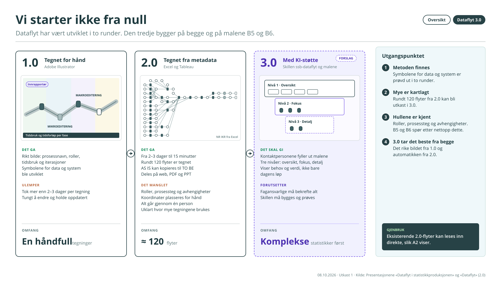
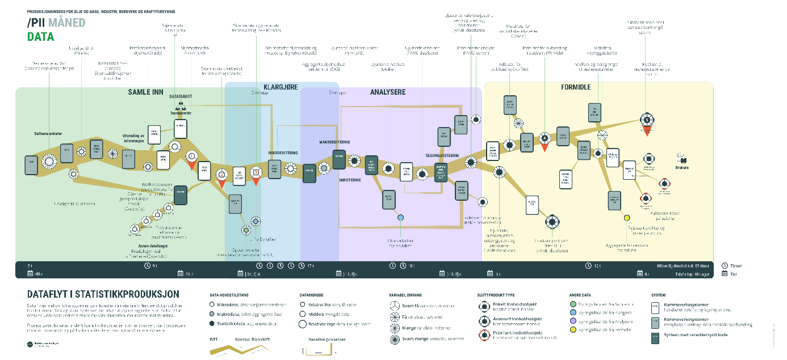
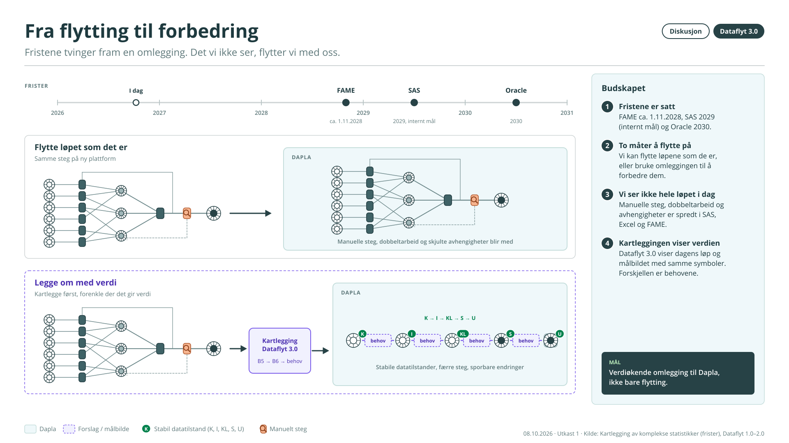
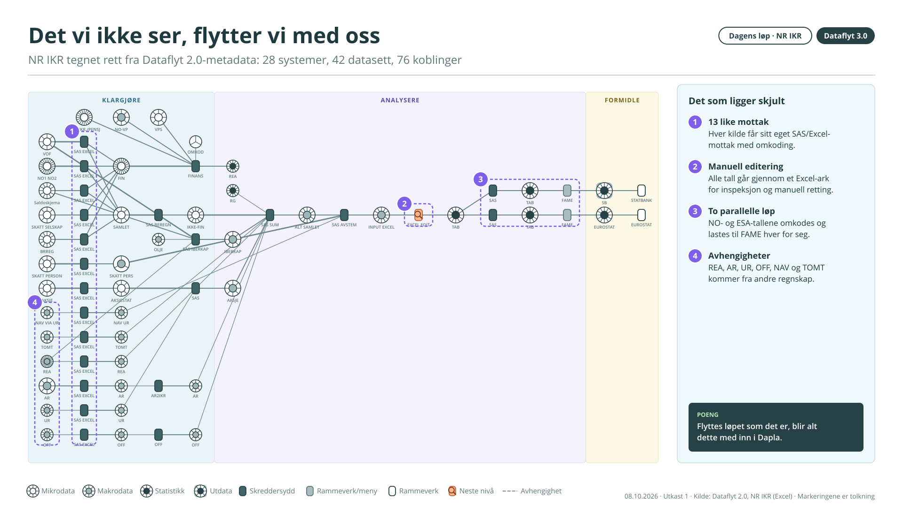

# 1 Hva er Dataflyt?

En statistikk blir til gjennom en lang rekke steg. Data samles inn, kobles, kontrolleres, rettes, aggregeres, avstemmes og publiseres. Hvert steg skjer i et system, og hvert system leverer et datasett videre til det neste. Få har oversikt over hele kjeden. De fleste kjenner godt sin egen del.

Dataflyt tegner hele kjeden på ett ark. Målet er å vise hva slags IT-systemer og programmer som er i sving når vi lager statistikk, og hvordan dataene beveger seg gjennom dem fra innsamling til formidling.

## Hva en dataflyt viser

En dataflyt har to hovedsymboler:

- **System:** et program, en applikasjon, en funksjon, en operasjon eller et verktøy som gjør noe med dataene.
- **Data:** et konkret datasett, en datafil eller en tabell som kommer ut av et system og går inn i det neste.

Symbolene står i rekkefølge fra venstre til høyre over fire fasebånd: samle inn, klargjøre, analysere og formidle. Strekene mellom dem viser hvor dataene går. Datasymbolene viser i tillegg hvilken tilstand dataene er i, hvor mye data det er, og hvor mange variabler datasettet har. Systemsymbolene viser hvor mye seksjonen selv kontrollerer koden. [Kapittel 2](2-symbolspraket.md) forklarer symbolene.

Tegningen beskriver ikke hvert program i detalj. Den forenkler, slik at helheten blir synlig.

## Hvorfor det er nyttig

Tilbakemeldingen fra de første tegningene var at det var spesielt nyttig å få identifisert alle deler av løpet, fra ende til ende. En felles tegning gir et felles språk. Den gjør det lettere å snakke om hva som må utvikles, hvem som er avhengige av hvem, og hvor det er risiko.

Den forståelsen er også grunnlaget for neste steg: å tegne et fremtidig løp, et målbilde, ut fra hvilke data som trengs, hvilke datatilstander de skal ha, og hvilke behandlinger som skal inngå.

Dataflyt er altså ikke dokumentasjon for sin egen del. Den er et arbeidsverktøy for å forstå dagens løsning godt nok til å kunne endre den.

## Tre versjoner

<figure class="figur" id="figur-a3" markdown="span">
  [{ loading=lazy }](figurer/A3.svg)
  <figcaption>Figur A3. Vi starter ikke fra null · <a href="figurer/A3.svg" download>Last ned SVG</a></figcaption>
</figure>

**Dataflyt 1.0 (fra 2021)** ble tegnet for hånd i Adobe Illustrator. Tegningene var rike: de viste prosessnavn, roller, tidsbruk per fase, iterative sløyfer og typer sluttprodukt. Det ble laget en håndfull slike, blant annet for produksjonsindeksen (pii), arbeidskraftundersøkelsen (aku), utslipp til luft, utenriksregnskapet og forskerpersonale. Ulempen var tiden: hver tegning tok flere dager, og de var tunge å holde oppdatert.

<figure class="bilde" markdown="span">
  [{ loading=lazy }](bilder/dataflyt-1-0-pii.png)
  <figcaption>Dataflyt 1.0: produksjonsindeksen for olje og gass, industri, bergverk og kraftforsyning (pii), tegnet i Illustrator.</figcaption>
</figure>

**Dataflyt 2.0 (fra 2023)** tegnes automatisk fra metadata. Statistikkprodusenten fyller ut en Excel-mal, én rad per system eller datasett, og Tableau tegner flyten. Det kortet tegnetiden fra to–tre dager til omkring 15 minutter, og rundt 120 flyter er tegnet på denne måten. Bakgrunnen var at SSB våren 2023 skulle flytte rundt 30 statistikker til Dapla på kort sikt, og at det var for tidkrevende å tegne dagens løp for hånd for alle.

Prisen var at noe av det 1.0 viste, falt bort. Roller, prosessteg og avhengigheter til andre statistikker har ikke egne felt i Excel-malen. Det er også krevende å få plassert alt i en horisontal rekkefølge, og mye av arbeidet har gått gjennom én person.

**Dataflyt 3.0 (fra 2026)** tar det beste fra begge. Symbolene og kodene fra 2.0 beholdes, så de eksisterende flytene kan brukes videre. Rollene, prosesstegene og avhengighetene fra 1.0 kommer tilbake, nå som felt i malene. Kartleggingen gjøres med maler som kontaktpersonen fyller ut, og tegningene lages med KI-støtte. Dataflyt 3.0 er knyttet til kartleggingen av komplekse statistikker før overgangen til Dapla, og til malene B5 og B6 som brukes der.

## Fra flytting til forbedring

<figure class="figur" id="figur-a1" markdown="span">
  [{ loading=lazy }](figurer/A1.svg)
  <figcaption>Figur A1. Fra flytting til forbedring · <a href="figurer/A1.svg" download>Last ned SVG</a></figcaption>
</figure>

Bakkesystemene skal fases ut. I kartleggingen høsten 2026 var fristene omtrent 1. november 2028 for FAME, 2029 for SAS (internt mål) og 2030 for Oracle. Fristene tvinger fram en omlegging, men de avgjør ikke hvordan.

Det finnes to måter å flytte på. Den ene er å flytte løpet som det er, steg for steg, til ny plattform. Den andre er å bruke omleggingen til å forbedre løpet: samle like steg, gjøre manuelle steg sporbare og lagre dataene i vedtatte tilstander. Den første er enklest å planlegge. Den andre gir mest igjen, men forutsetter at vi ser hele løpet.

Det er her Dataflyt 3.0 har sin viktigste oppgave. Uten et felles bilde av dagens løp ser vi ikke hva som kan forenkles, og da flytter vi dagens kompleksitet med oss.

<figure class="figur" id="figur-a2" markdown="span">
  [{ loading=lazy }](figurer/A2.svg)
  <figcaption>Figur A2. Det vi ikke ser, flytter vi med oss · <a href="figurer/A2.svg" download>Last ned SVG</a></figcaption>
</figure>

Figur A2 viser nasjonalregnskapets inntekts- og kapitalregnskap (NR IKR), tegnet rett fra Excel-filen i Dataflyt 2.0. Figuren viser 28 systemer, 42 datasett og 76 koblinger. De lilla markeringene peker på fire forhold som er lett å overse, men som får betydning når løpet skal legges om. [Kapittel 6](6-eksempel-nr-ikr.md) går gjennom eksemplet.

## Det som er nytt i 3.0

| | Dataflyt 2.0 | Dataflyt 3.0 |
|---|---|---|
| **Formål** | Tegne dagens løp | Tegne dagens løp og peke på behov og verdi i målbildet |
| **Innsamling** | Excel-mal, fylt ut av fagseksjonen | Maler D1–D3 på nett, workshop med malene B5 og B6 |
| **Tegning** | Tableau, fra koordinater i Excel | KI-støtte med skillen ssb-dataflyt, eller Tableau |
| **Nivåer** | Ett: alle systemer og datasett | Tre: oversikt, fokus og detalj |
| **Roller og prosessteg** | Ikke med | Egne felt |
| **Avhengigheter** | Tegnet som vanlige kilder | Egen koblingstype og egne felt |
| **Datatilstand** | Datatype (mikro, makro, statistikk, ut) | Datatype og stabil Dapla-tilstand (kildedata, inndata, klargjorte data, statistikk, utdata) |
| **Målbilde** | Kopi av AS IS, justert for hånd | Eget skjelett med behov, ikke løsninger |
| **Kvalitetssikring** | Gjennomgang med seksjonen | Kildemerke på alt, liste over det som må bekreftes, to porter |

## Hva Dataflyt ikke er

Dataflyt er ikke et fullstendig arkitekturkart. Den viser ikke servere, nettverk eller tilganger. Den dekker heller ikke hele GSBPM, bare de fire hovedfasene samle inn, klargjøre, analysere og formidle. Og den er ikke eksakt: en tegning er et forenklet bilde som fagmiljøet har godkjent som riktig nok for formålet.

Det er en styrke. En tegning som prøver å vise alt, blir uleselig. En tegning som viser det som betyr noe for neste beslutning, blir brukt.
