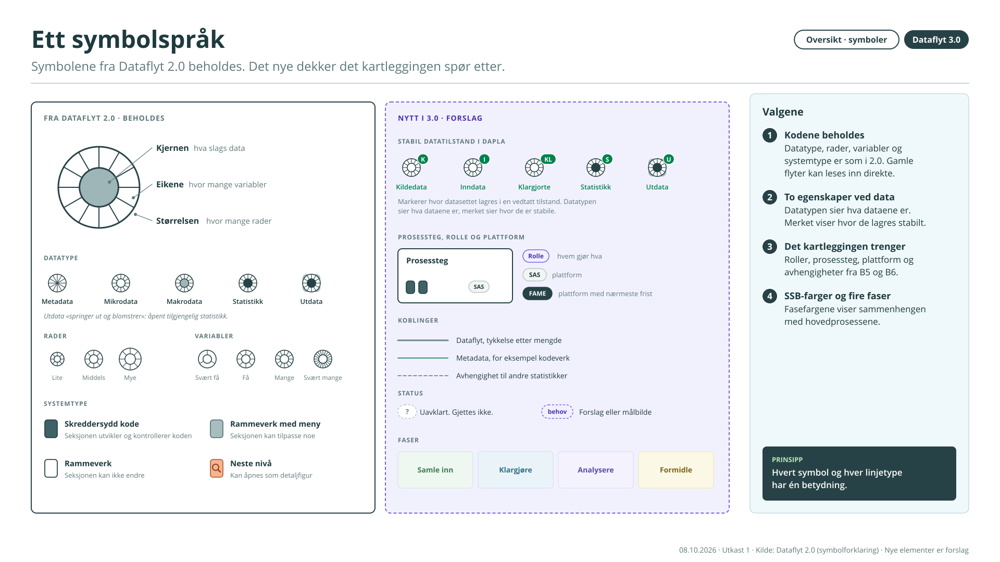
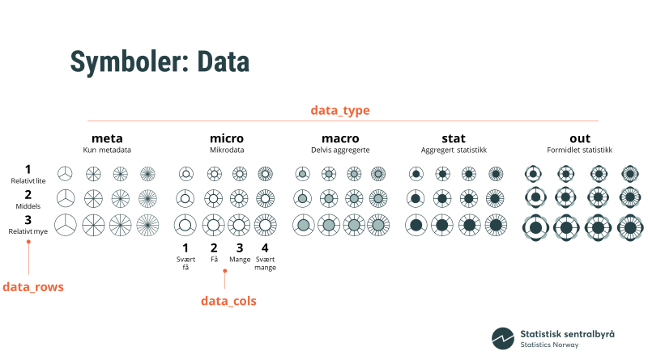
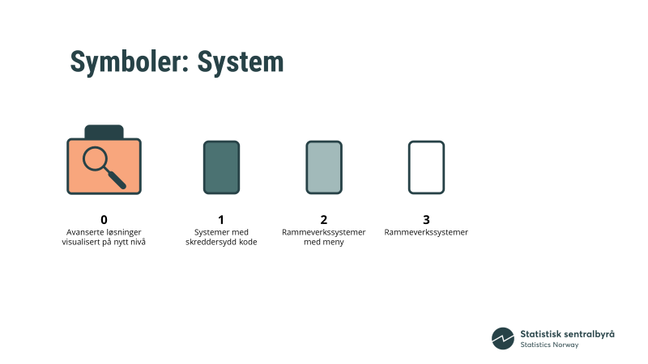

# 2 Symbolspråket

Dataflyt har sitt eget symbolspråk. Det ble utviklet i 1.0, er brukt i alle tegningene fra 2.0, og beholdes i 3.0. Hvert symbol og hver strek har én betydning, og betydningen står i tegnforklaringen.

<figure class="figur" id="figur-b2" markdown="span">
  [{ loading=lazy }](figurer/B2.svg)
  <figcaption>Figur B2. Ett symbolspråk · <a href="figurer/B2.svg" download>Last ned SVG</a></figcaption>
</figure>

## Data

Et datasymbol er en sirkel som sier tre ting om datasettet: hva slags data det er, hvor mye data det er, og hvor mange variabler det har.

<figure class="bilde" markdown="span">
  [{ loading=lazy }](bilder/symboler-data.png)
  <figcaption>Datasymbolene fra Dataflyt 2.0: datatype, mengde rader (data_rows) og antall variabler (data_cols).</figcaption>
</figure>

**Kjernen** viser datatypen:

| Kode | Datatype | Kjerne | Betydning |
|---|---|---|---|
| `meta` | Metadata | Ingen kjerne, bare eiker | Kodelister, kataloger og annen beskrivelse av data |
| `micro` | Mikrodata | Hvit | Opplysninger om enkeltenheter: personer, foretak, transaksjoner |
| `macro` | Makrodata | Grågrønn | Delvis aggregerte data |
| `stat` | Statistikk | Mørk | Ferdig aggregert statistikk, ikke publisert |
| `out` | Utdata | Mørk med «blader» | Formidlet statistikk som er åpent tilgjengelig |
| `qual` | Kvalitetsindikator | – | Definert i malen, men har ikke eget symbol og er nesten aldri brukt |

Utdata har fire blader rundt sirkelen. Bildet er at dataene springer ut og blomstrer når de når brukerne. Bladene brukes bare for det som er åpent tilgjengelig. En leveranse som ikke er åpen, for eksempel til Eurostat, tegnes som statistikk.

**Størrelsen** viser hvor mye data det er, med tre størrelser: 1 relativt lite, 2 middels og 3 relativt mye.

**Eikene** viser hvor mange variabler datasettet har, gjerne antall kolonner: 1 svært få (3 eiker), 2 få (8 eiker), 3 mange (12 eiker) og 4 svært mange (20 eiker).

### Sluttprodukter

Utdata kan tegnes med fire varianter av bladene. De kommer fra tegnforklaringen i 1.0, der de het innholdsobjekter:

| Variant | Blader | Brukes for |
|---|---|---|
| Enkelt sluttprodukt | Mørke | Relativt enkelt innhold, for eksempel en tabell i Statistikkbanken |
| Avansert sluttprodukt | Grågrønne | Mer sammensatt innhold |
| Prioritert sluttprodukt | Røde og oransje | Framhevet og sammensatt innhold |
| Mikrodata som produkt | Mørke, rundt en hvit kjerne | Mikrodata som leveres ut, for eksempel til forskning |

### Styringsdata

Små fylte sirkler i fasefargene viser styringsdata og andre data som oppstår underveis: rapporter, logger og kontrollresultater fra samle inn (grønn), klargjøre (blå), analysere (lilla) og formidle (gul). De ble tegnet i 1.0, men har ikke eget felt i Excel-malen fra 2.0.

## System

Et systemsymbol er et avrundet rektangel. Fargen viser hvem som kontrollerer koden.

<figure class="bilde" markdown="span">
  [{ loading=lazy }](bilder/symboler-system.png)
  <figcaption>Systemsymbolene fra Dataflyt 2.0: avanserte løsninger (0), skreddersydd kode (1), rammeverk med meny (2) og rammeverk (3).</figcaption>
</figure>

| Kode | Systemtype | Symbol | Betydning |
|---|---|---|---|
| `1` | System med skreddersydd kode | Mørkt | Fagseksjonen har utviklet koden selv og kan endre den |
| `2` | Rammeverkssystem med meny | Grått | Utviklet av andre, men seksjonen kan tilpasse noe gjennom menyer |
| `3` | Rammeverkssystem | Hvitt | Utviklet av andre enheter. Seksjonen kan ikke endre noe selv |
| `0` | Avanserte løsninger | Oransje med lupe | En samling løsninger som krever en egen tegning. Kan åpnes som detaljfigur |

## Streker

**Dataflyt** er en heltrukken strek fra et symbol til det neste. Tykkelsen følger mengden data i datasettet strekene går ut fra. I 2.0 er streken okergul, slik den var i 1.0. I 3.0 er den dempet blågrå, i SSBs palett.

Flyten kan gå fra ett til ett, flere kan gå sammen til ett (en *merge*), og ett kan deles til flere (en *split*). I 1.0 ble iterative prosesser vist som sløyfer tilbake. Det støttes ikke i 2.0.

I 3.0 kommer to nye linjetyper:

- **Metadata:** tynn grønn strek, for eksempel fra en kodeliste til systemet som bruker den.
- **Avhengighet:** stiplet grå strek, til og fra andre statistikker, registre og eksterne.

## Fasebånd

Fasebåndene er svake bakgrunner som viser de fire hovedprosessene:

| Fase | Farge | Kode i 2.0 |
|---|---|---|
| Samle inn | Lys grønn | `collect` |
| Klargjøre | Lys blå | `process` |
| Analysere | Lys lilla | `analyse` |
| Formidle | Lys gul | `disseminate` |

I 2.0 ble båndene tegnet for hånd i Tableau, og fasen sto på hvert symbol. Det viste seg vanskelig å få til, fordi alt måtte ligge i en streng rekkefølge fra venstre mot høyre. I 3.0 settes fasen på prosesssteget, og båndene kan overlappe der løpet faktisk gjør det.

## Nytt i 3.0

| Element | Hvordan det tegnes | Hva det viser |
|---|---|---|
| **Stabil datatilstand** | Grønn pille med K, I, KL, S eller U på datasymbolet | Hvor datasettet lagres i en vedtatt Dapla-tilstand: kildedata, inndata, klargjorte data, statistikk eller utdata |
| **Prosessteg** | Hvit boks med mørk kant | En gruppe systemer og datasett som sammen gjør én ting, på nivå 1 |
| **Plattform** | Grå pille, for eksempel SAS eller FAME | Hvilket bakkesystem eller verktøy steget kjører på. Kan farges etter frist |
| **Rolle** | Lilla pille | Hvem som gjør steget. Stiplet «Rolle: ?» når det ikke er kartlagt |
| **Eksterne** | Grå stiplet boks utenfor fasebåndene | Andre statistikker, registre og leverandører |
| **Uavklart** | Stiplet grått, med «?» | Det som ikke er vurdert. Det gjettes aldri |
| **Forslag og behov** | Stiplet lilla | Målbilde og forslag som ikke er vedtatt |

**Datatype og datatilstand er to ulike ting.** Datatypen sier hva dataene er: mikrodata, makrodata eller statistikk. Datatilstanden sier hvor de lagres i en vedtatt tilstand i Dapla. Underveis i et løp kan det oppstå mange mikrodatasett, mens bare ett av dem lagres som inndata. Derfor beholder 3.0 datatypen som symbol og legger tilstanden til som et merke.

## Farger

Konseptfigurene i 3.0 bruker SSBs farger slik de er beskrevet i skillen ssb-konseptfigurer, og legger til de fire fasefargene. Lilla betyr roller og forslag. Grønt betyr data og datatilstand. Grått betyr uavklart eller utenfor.

Alle symbolene kan lastes ned som SVG fra siden med [grafiske elementer](grafiske-elementer.md).
