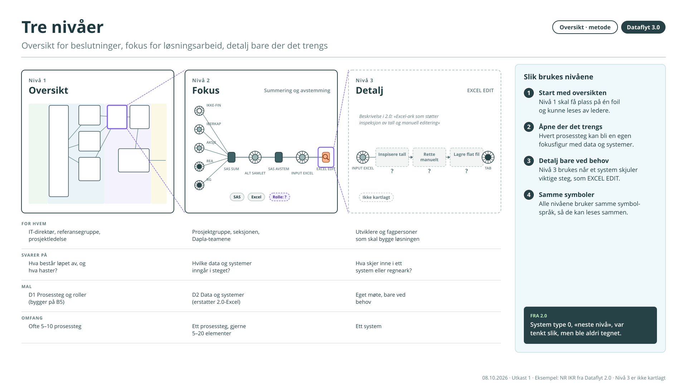
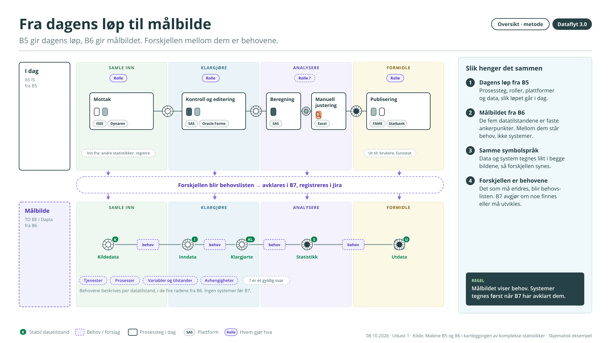
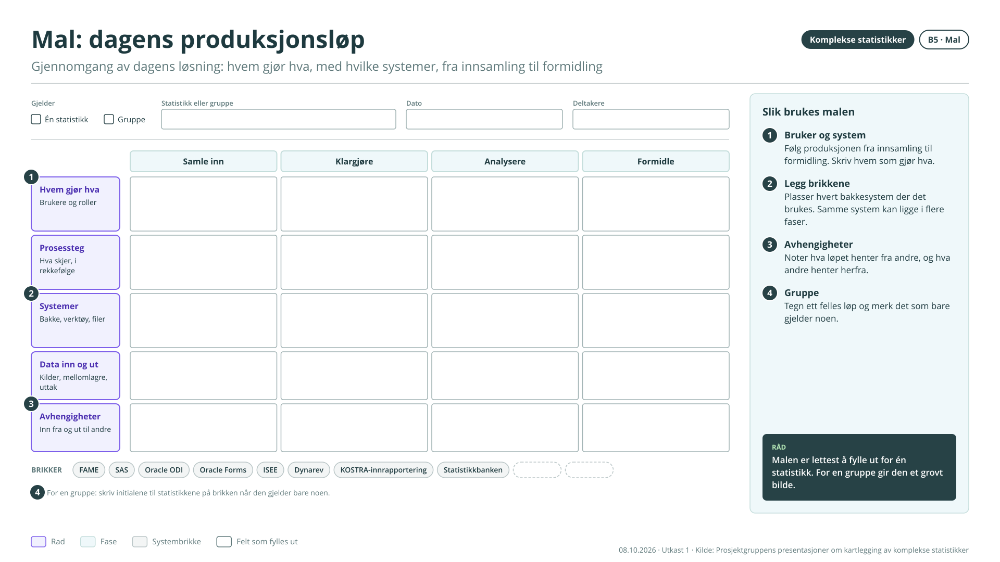
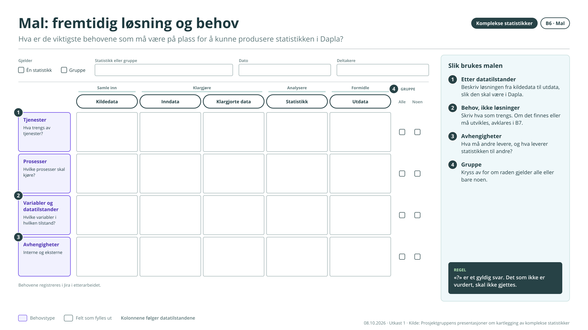
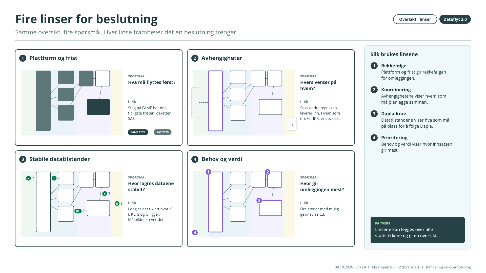

# 3 Tegningene

En tegning skal svare på ett spørsmål for én målgruppe. Derfor lager Dataflyt 3.0 flere tegninger av samme løp, på ulike nivåer og med ulike linser, i stedet for én stor tegning som skal gjøre alt.

## Tre nivåer

<figure class="figur" id="figur-b1" markdown="span">
  [{ loading=lazy }](figurer/B1.svg)
  <figcaption>Figur B1. Tre nivåer · <a href="figurer/B1.svg" download>Last ned SVG</a></figcaption>
</figure>

**Nivå 1 Oversikt** viser hele løpet som 5–10 prosessteg over fasebåndene, med plattformer, roller, avhengigheter inn og ut, og de viktigste datasettene mellom stegene. Den skal få plass på én foil og kunne leses av ledere. Spørsmålet er: hva består løpet av, og hva haster?

**Nivå 2 Fokus** åpner ett prosessteg og viser alle systemer og datasett i det, med navn. Det er dette nivået Dataflyt 2.0 tegnet for hele løpet på én gang. Spørsmålet er: hvilke data og systemer inngår i steget?

**Nivå 3 Detalj** åpner ett system, typisk et system av type 0, og viser hva som skjer inne i det. Det brukes bare når et system skjuler viktige steg, for eksempel et regneark der tall rettes for hånd. Det som ikke er kartlagt, tegnes stiplet grått med «?».

Alle nivåene bruker samme symboler, så de kan leses sammen. I 2.0 var systemtype 0 tenkt som en vei inn til et neste nivå, men det ble aldri tegnet. I 3.0 er det en del av metoden.

## Fra dagens løp til målbilde

<figure class="figur" id="figur-b3" markdown="span">
  [{ loading=lazy }](figurer/B3.svg)
  <figcaption>Figur B3. Fra dagens løp til målbilde · <a href="figurer/B3.svg" download>Last ned SVG</a></figcaption>
</figure>

Kartleggingen av komplekse statistikker bruker to maler som utfyller Dataflyt: B5 for dagens produksjonsløp og B6 for fremtidig løsning og behov.

<figure class="figur" id="figur-kb5" markdown="span">
  [{ loading=lazy }](figurer/KB5.svg)
  <figcaption>Mal fra kartleggingen, B5. Mal: dagens produksjonsløp · <a href="figurer/KB5.svg" download>Last ned SVG</a></figcaption>
</figure>

**B5** følger løpet fra innsamling til formidling, med radene hvem gjør hva, prosessteg, systemer, data inn og ut, og avhengigheter. Dataflyt dekker godt radene for systemer og data, delvis prosesstegene og nesten ikke rollene. B5 fyller hullene. Sammen gir de dagens løp (AS IS) på nivå 1.

<figure class="figur" id="figur-kb6" markdown="span">
  [{ loading=lazy }](figurer/KB6.svg)
  <figcaption>Mal fra kartleggingen, B6. Mal: fremtidig løsning og behov · <a href="figurer/KB6.svg" download>Last ned SVG</a></figcaption>
</figure>

**B6** beskriver målbildet etter de fem datatilstandene i Dapla: kildedata, inndata, klargjorte data, statistikk og utdata. Radene er tjenester, prosesser, variabler og tilstander, og avhengigheter. B6 spør etter behov, ikke løsninger. Om noe finnes i Dapla eller må utvikles, avklares senere, i B7.

Det gir en viktig regel for målbildet i Dataflyt: **målbildet viser behov, ikke systemer.** Datatilstandene er faste ankerpunkter, og mellom dem står behovene som stiplede lilla bokser. Systemsymboler tegnes først når det er avklart hva som skal brukes. Forskjellen mellom dagens løp og målbildet er behovslisten, og den går videre til avklaring og registreres i Jira.

## Fire linser

<figure class="figur" id="figur-b4" markdown="span">
  [{ loading=lazy }](figurer/B4.svg)
  <figcaption>Figur B4. Fire linser for beslutning · <a href="figurer/B4.svg" download>Last ned SVG</a></figcaption>
</figure>

En linse er samme oversikt, farget for å svare på ett spørsmål:

| Linse | Spørsmålet | Hva den framhever |
|---|---|---|
| **Plattform og frist** | Hva må flyttes først? | Plattformbrikkene farget etter fristen for bakkesystemet: FAME mørkest, så SAS, så Oracle |
| **Avhengigheter** | Hvem venter på hvem? | Det løpet henter fra andre statistikker, og hvem som bruker det som kommer ut |
| **Stabile datatilstander** | Hvor lagres dataene stabilt? | Hvor K, I, KL, S og U ligger i dag, eller at det er uklart |
| **Behov og verdi** | Hvor gir omleggingen mest? | Nummererte markører på steder med mulig gevinst |

Linsene kan legges over alle statistikkene i en kartlegging. Da gir de én oversikt på tvers: hvilke plattformer som bærer flest løp, hvilke statistikker som henger sammen, og hvor behovene går igjen.

## Regler for tegningene

- **Én figur, ett spørsmål, én primær målgruppe.**
- **Status skal synes, og gjettes aldri:** finnes, under arbeid, forslag eller uavklart. Det som ikke er vurdert, vises med «?».
- **Bruk de etablerte navnene** på systemer og datasett. Gi ikke nye navn til noe som finnes. Samme navn kan forekomme flere steder i løpet, fordi samme system kan gjøre ulike ting på ulike steder.
- **Flyten går fra venstre til høyre.** Rekkefølgen kommer fra koblingene, ikke fra koordinater.
- **Eksterne står utenfor fasebåndene:** det løpet henter fra til venstre, og det det leverer til høyre.
- **Mange like steg samles.** Tretten nesten like mottak blir ett prosessteg med tretten små systemsymboler, ikke tretten bokser.
- **Målbilder merkes FORSLAG** eller Scenario. Det som er tolket og ikke bekreftet, står i bunnlinjen og i kvalitetssikringslisten.
- **Fagmiljøet godkjenner.** En tegning er ikke ferdig før den som eier løpet, har sagt at den er riktig nok.
