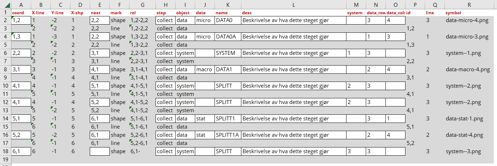

# 4 Datamodellen

En dataflyt er data før den er en tegning. I 2.0 er dataene en Excel-tabell som Tableau tegner fra. I 3.0 er de en modell per statistikk, som malene fyller og tegningene lages fra. Dette kapittelet beskriver begge, og hvordan en tegning fra 2.0 oversettes til 3.0.

## Excel-malen i 2.0

I Excel-malen fyller statistikkprodusenten inn ett element per rad: et system eller et datasett. Malen gjør rekkefølgen om til koordinater og legger på det Tableau trenger for å tegne. Feltene med grå bakgrunn regnes ut av formler og skal ikke endres.

<figure class="bilde" markdown="span">
  [{ loading=lazy }](bilder/dataflyt-2-0-excel-mal.png)
  <figcaption>Tabellen bak et eksempel i Excel-malen. Hvert element står på to rader: én for symbolet og én for streken videre.</figcaption>
</figure>

### Feltene du fyller ut

**Rekkefølge | `coord`.** Angir rekkefølgen fra venstre til høyre og plasseringen i høyden. Skriv som desimaltall formatert som tekst: `1,1` ligger øverst til venstre, `2,2` ligger ett steg til høyre og ett steg ned.

**Hvor går flyten videre? | `next`.** Samme angivelse som `coord`, for elementet dette skal kobles til. Ved ren sekvensiell flyt går det mot høyre, én til én. Flere elementer kan gå til samme element (merge), og ett element kan deles til flere (split). Ved split må raden dupliseres, én gang per element den skal videre til. Et element som er siste ledd, har `next` lik sin egen `coord`.

**Steg i virksomhetsprosessen | `step`.** `collect`, `process`, `analyse` eller `disseminate`. Elementer som ligger rett etter hverandre, bør helst være i samme steg.

**System eller datasett? | `object`.** `system` eller `data`.

**Hvis data, hva slags type? | `data`.** `meta`, `micro`, `macro`, `stat`, `out` eller `qual`. Se [kapittel 2](2-symbolspraket.md#data).

**Navn | `name`.** Det navnet systemet eller datafilen vanligvis omtales med. Helst kort. Detaljer hører hjemme i beskrivelsen.

**Beskrivelse | `desc`.** En kort, presis beskrivelse av hva elementet er og hva som skjer i steget. Teksten vises når man holder musepekeren over symbolet, og noen sentrale beskrivelser kan stå synlig i tegningen.

**Systemtype | `system`.** `0` avanserte løsninger, `1` skreddersydd kode, `2` rammeverkssystem med meny, `3` rammeverkssystem.

**Hvor mye data? | `data_rows`.** `1` relativt lite, `2` middels, `3` relativt mye. For systemer settes `3`.

**Hvor mange variabler? | `data_cols`.** `1` svært få, `2` få, `3` mange, `4` svært mange.

### Feltene som regnes ut

| Felt | Hva formelen gjør |
|---|---|
| `X-line`, `Y-line` | Første og andre siffer i `coord` (for symbolraden) og i `next` (for streken). `Y-line` ganges med −1, så tegningen sorteres fra topp til bunn |
| `X-shp` | Kopi av `X-line`. Brukes som egen akse for symbolene |
| `mark` | `shape` på første rad, `line` på andre |
| `rel` | En relasjon mellom `coord` og `next`, som Tableau bruker til å trekke streken |
| `id` | Kopi av `coord` på linjeraden |
| `line` | Kopi av `data_rows`. Styrer tykkelsen på streken |
| `symbol` | Filnavnet på symbolet, for eksempel `data-micro-4.png` eller `system--1.png` |

Hvert element står på to rader. Den første tegner symbolet, den andre streken videre. Malen lager den andre raden av den første.

### Svakheter i 2.0-modellen

Erfaringen med rundt 120 flyter viser noen svakheter. De er grunnen til at modellen er endret i 3.0:

- **Koordinaten er både plassering og identitet.** Flytter du et element, må alle koblinger til det endres.
- **Ett element med flere utganger står på flere rader,** med alle opplysningene gjentatt. Det gir lett motstrid.
- **`step` styrer ikke fasebåndene.** De ble tegnet for hånd, og elementer kan havne i et annet bånd enn det `step` sier.
- **Det er bare én type strek.** Metadata og avhengigheter til andre statistikker tegnes som vanlig dataflyt.
- **Roller, prosessteg, plattform og datatilstand har ingen felt.**

## Modellen i 3.0

I 3.0 beskrives hver statistikk av én modell. Malene D1–D3 fyller den, en eksisterende 2.0-fil kan leses inn i den, og alle tegningene lages fra den. Modellen skrives som YAML, slik at både mennesker og KI kan lese og endre den.

```yaml
statistikk: {kortnavn: NR IKR, navn: Inntekts- og kapitalregnskapet, gruppe: false}
versjon: {dato: 2026-10-08, status: utkast, kilder: ["Dataflyt 2.0", "D1"]}

prosessteg:
  - id: P5
    navn: Summering og avstemming
    fase: analyse              # samle | klargj | analyse | formidle
    hva: Summerer alle kilder og avstemmer
    rolle: "?"                 # rolle, ikke navn
    plattformer: [SAS]
    gjelder: alle              # alle | noen (for grupper)
    kilde: tolkning

objekter:
  - id: S1
    navn: SAS SUM
    objekt: system
    systemtype: 1              # 0, 1, 2 eller 3
    plattform: SAS
    prosessteg: P5
    beskrivelse: SAS-applikasjon som summerer alle kilder
    status: finnes             # finnes | under arbeid | forslag | "?"
    kilde: "2.0"
    ref_2_0: "7,5"             # koordinaten i 2.0, for sporbarhet
  - id: D1
    navn: ALT SAMLET
    objekt: data
    datatype: macro            # meta | micro | macro | stat | out | qual
    rader: 2                   # 1, 2 eller 3
    variabler: 3               # 1, 2, 3 eller 4
    stabil: "?"                # K | I | KL | S | U | ingen | "?"
    prosessteg: P5

koblinger:
  - {fra: S1, til: D1, type: dataflyt}   # dataflyt | metadata | avhengighet

eksterne:
  - {id: X_REA, navn: REA, retning: inn, type: statistikk}

behov:                         # bare i målbildet
  - id: B1
    tilstand: I
    type: tjeneste             # tjeneste | prosess | variabler | avhengighet
    behov: Felles mottak og omkoding av kilder
    erstatter: [P1]
    verdi: Én testet rutine, mindre vedlikehold
    risiko: 13 SAS-rutiner må flyttes før 2029
    finnes_i_dapla: "?"        # ja | nei | "?"
    kilde: tolkning
```

Reglene i modellen:

- **ID-en er uavhengig av plasseringen.** Koordinater kan stå som valgfrie hint, men rekkefølgen utledes av koblingene.
- **Alt har et kildemerke:** D1, D2, D3, 2.0, workshop eller tolkning. Da kan kvalitetssikringslisten lages automatisk.
- **«?» er en verdi.** Det skal stå til noen faktisk har svart.
- **Datatype og stabil tilstand er to felt.** Se [kapittel 2](2-symbolspraket.md#nytt-i-30).

## Fra 2.0 til 3.0

En flyt fra 2.0 kan leses inn i modellen uten å fylle ut noe på nytt. Det meste kan oversettes direkte. Resten blir «?» eller tolkning som må bekreftes.

| 2.0 | 3.0 | Merknad |
|---|---|---|
| `coord` | ny `id`, og `ref_2_0` | Duplikater med samme koordinat slås sammen til ett objekt |
| `next` | `koblinger` | `next` lik `coord` betyr sluttnode |
| `object` | `objekt` | |
| `data` | `datatype` | |
| `system` | `systemtype` | |
| `data_rows`, `data_cols` | `rader`, `variabler` | For systemer ignoreres `data_rows` |
| `step` | `fase` på prosesssteget | Sjekkes mot plasseringen i tegningen |
| `name`, `desc` | `navn`, `beskrivelse` | Navnene beholdes |
| – | `plattform` | Utledes av navnet når det er tydelig (SAS, FAME, Excel). Merkes som tolkning |
| – | prosessteg | Foreslås ved å gruppere objekter. Alltid tolkning til det er bekreftet |
| – | rolle, avhengigheter ut, stabil tilstand, behov | Settes til «?» |

Elementer helt til venstre som egentlig er andre statistikker, for eksempel regnskap som et nasjonalregnskap henter fra, flyttes til `eksterne` og kobles med avhengighetsstreker.
