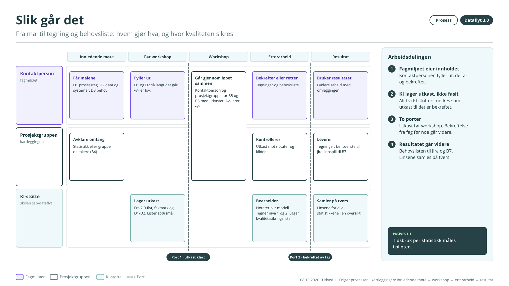
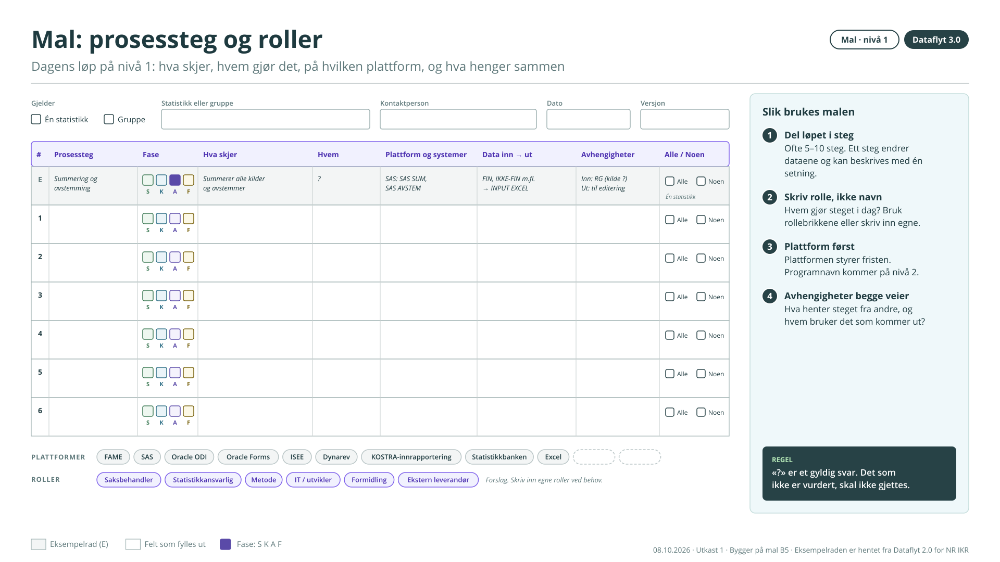
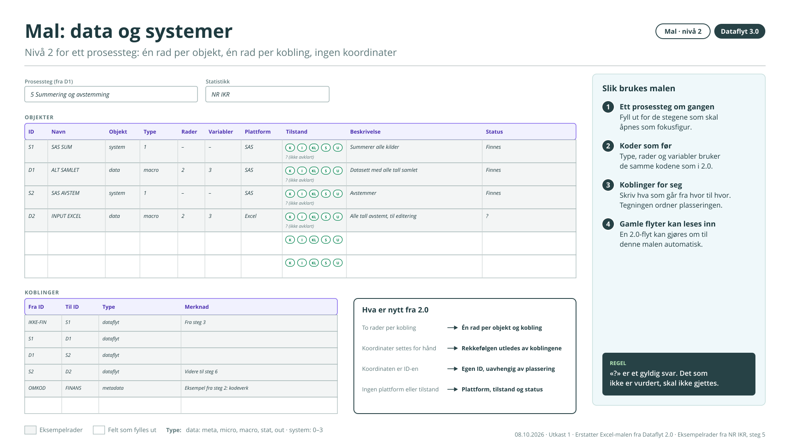
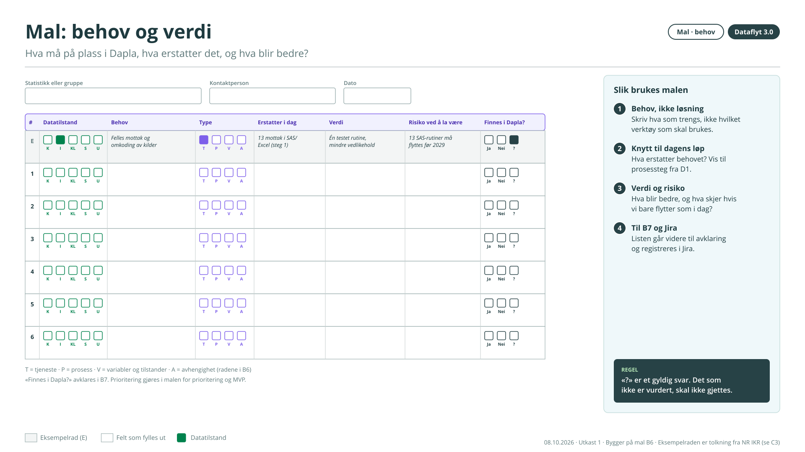

# 5 Slik kartlegger du

Kartleggingen er det viktigste arbeidet. Tegningen kan lages raskt når innholdet er på plass. Å finne alle systemene og datasettene i løpet, beskrive dem og sette dem i riktig rekkefølge tar tid, og det kan bare gjøres av dem som kjenner løpet.

Dette kapittelet beskriver løpet i Dataflyt 3.0. Det følger prosessen i kartleggingen av komplekse statistikker: innledende møte, workshop, etterarbeid og resultat.

## Løpet

<figure class="figur" id="figur-d4" markdown="span">
  [{ loading=lazy }](figurer/D4.svg)
  <figcaption>Figur D4. Slik går det · <a href="figurer/D4.svg" download>Last ned SVG</a></figcaption>
</figure>

| Fase | Kontaktperson (fagmiljøet) | Prosjektgruppen | KI-støtte |
|---|---|---|---|
| **Innledende møte** | Får malene D1–D3 | Avklarer omfang: én statistikk eller en gruppe, og hvem som deltar | |
| **Før workshop** | Fyller ut D1 og D2 så langt det går. «?» er lov | | Lager et utkast fra 2.0-flyten, faktaark og D1/D2, og lister spørsmål |
| **Port 1: utkastet er klart** | | | |
| **Workshop** | Går gjennom løpet sammen med prosjektgruppen, med B5, B6 og utkastet | Leder gjennomgangen og avklarer «?» | |
| **Etterarbeid** | Bekrefter eller retter tegninger og behovsliste | Kontrollerer utkastet mot notater og kilder | Gjør notatene om til modell, tegner nivå 1 og 2, lager kvalitetssikringsliste |
| **Port 2: bekreftet av fag** | | | |
| **Resultat** | Bruker resultatet i det videre arbeidet med omleggingen | Leverer tegninger, behovsliste til Jira og innspill til B7 | Samler linsene for alle statistikkene i én oversikt |

Tre ting gjør løpet robust:

- **Fagmiljøet eier innholdet.** Kontaktpersonen fyller ut, deltar og bekrefter. Ingen tegning går videre uten at den er bekreftet.
- **KI lager utkast, ikke fasit.** Alt KI-støtten lager, er merket som utkast, med kildemerke på hvert element, til det er bekreftet.
- **To porter.** Det skal finnes et utkast før workshopen, så tiden brukes på å rette og ikke på å begynne fra null. Og fagmiljøet bekrefter før noe går videre.

## Før workshopen

### Start med det som finnes

Har statistikken en tegning fra Dataflyt 2.0, er den et godt utgangspunkt. Excel-filen kan leses rett inn og gi et utkast til både nivå 1 og nivå 2. Faktaark, tidligere dokumentasjon og B4 fra det innledende møtet gir også mye.

### Fyll ut D1 og D2

<figure class="figur" id="figur-d1" markdown="span">
  [{ loading=lazy }](figurer/D1.svg)
  <figcaption>Figur D1. Mal: prosessteg og roller · <a href="figurer/D1.svg" download>Last ned SVG</a></figcaption>
</figure>

**[Mal D1 Prosessteg og roller](maler/d1.md)** beskriver løpet på nivå 1. Del løpet i steg fra innsamling til formidling, ofte 5–10. Et steg er noe som endrer dataene og kan beskrives med én setning. For hvert steg skriver du fase, hva som skjer, hvem som gjør det, hvilken plattform det kjører på, hvilke data som går inn og ut, og avhengigheter. Skriv rolle, ikke navn. Plattform først, programnavn kommer i D2.

<figure class="figur" id="figur-d2" markdown="span">
  [{ loading=lazy }](figurer/D2.svg)
  <figcaption>Figur D2. Mal: data og systemer · <a href="figurer/D2.svg" download>Last ned SVG</a></figcaption>
</figure>

**[Mal D2 Data og systemer](maler/d2.md)** beskriver nivå 2: alle datasett og systemer, ett prosessteg om gangen, og koblingene mellom dem. Den bruker de samme kodene som Excel-malen fra 2.0, men uten koordinater. Hvert objekt får en ID, og koblingene skrives med ID-ene. Tegningen ordner plasseringen.

Det er ikke nødvendig å fylle ut D2 for hele løpet. Begynn med de stegene som er mest komplekse, eller der det er mest usikkerhet.

### Analogt, hvis dere heller vil det

Mange får mest ut av å starte på papir. Skriv ut A3-rutenettet, tegn systemene og datasettene med blyant, og diskuter rekkefølgen rundt bordet. Rutenettet har koordinater 1–10, 11–20 og 21–30, slik at plasseringen kan overføres til Excel-malen fra 2.0. Se [kapittel 7](7-verktoy.md#a3-maler-til-workshop).

## I workshopen

Workshopen går gjennom dagens løp med B5 som arbeidsflate og utkastet fra Dataflyt som underlag. Målet er ikke en perfekt tegning, men å avklare det som er usikkert og få fram det som mangler:

- **Hvem gjør hva?** Rollene finnes sjelden i eksisterende dokumentasjon.
- **Hva skjer manuelt?** Regneark, retting for hånd og kontroller som ikke er automatisert er lette å overse, og de er ofte der risikoen ligger.
- **Hvem er dere avhengige av,** og hvem er avhengige av dere?
- **Hvor lagres dataene stabilt i dag?** Og hvor bør de lagres i Dapla?

Etter gjennomgangen av dagens løp brukes B6 for målbildet: hva må på plass for å kunne produsere statistikken i Dapla?

## Etter workshopen

### Fyll ut D3

<figure class="figur" id="figur-d3" markdown="span">
  [{ loading=lazy }](figurer/D3.svg)
  <figcaption>Figur D3. Mal: behov og verdi · <a href="figurer/D3.svg" download>Last ned SVG</a></figcaption>
</figure>

**[Mal D3 Behov og verdi](maler/d3.md)** samler behovene for målbildet, ett per rad. For hvert behov angir du hvilken datatilstand det hører til, hva slags behov det er (tjeneste, prosess, variabler og tilstander, eller avhengighet), hva det erstatter i dagens løp, hvilken verdi det gir, og hva risikoen er ved å la være. Skriv behov, ikke løsninger. Om noe finnes i Dapla, avklares i B7.

Kolonnene for verdi og risiko er det som skiller Dataflyt 3.0 fra en ren kartlegging. De gjør det mulig å se hvor omleggingen gir mest igjen, og hva det koster å bare flytte.

### Lag tekst til skillen

Når malene er fylt ut, trykker du **Lag tekst til skillen** på [oversikten over malene](maler/index.md#svarene-dine). Teksten samler alt du har skrevet og ber skillen ssb-dataflyt om modell, tegninger og kvalitetssikringsliste. Lim den inn i en samtale med Claude. Legg gjerne ved Excel-filen fra 2.0 hvis den finnes.

### Kvalitetssikre

Det KI-støtten leverer, er et utkast med en kvalitetssikringsliste. Listen er fordelt på hvem som må bekrefte: fagmiljøet, prosjektledelsen eller den som har tegnet. Typiske punkter:

- inndelingen i prosessteg, som nesten alltid er en tolkning
- plattformer som er utledet av programnavn
- datasett uten kjent kilde
- verdi og gevinster som er foreslått, men ikke vurdert av fagmiljøet

Først når listen er gått gjennom og fagmiljøet har bekreftet, er tegningene ferdige.

## Gode råd

- **Ett spørsmål om gangen.** En kartlegging som stiller tjue spørsmål på én gang, får halve svar.
- **«?» er et gyldig svar.** Det som ikke er vurdert, skal ikke gjettes. Et tomt felt er bedre enn et feil felt.
- **Navnene skal være de dere bruker.** Skriv navnet slik det står i koden eller i mappen, og forklar heller i beskrivelsen.
- **Begynn med én statistikk.** Malene kan brukes for en gruppe statistikker, med «alle» eller «noen» per rad, men de er lettest å fylle ut for én.
- **Tegn skillet når det finnes.** Hvis løpet har et juridisk eller organisatorisk skille, for eksempel mellom to seksjoner eller en ekstern leverandør, skal tegningen vise det og ikke glatte det over.
