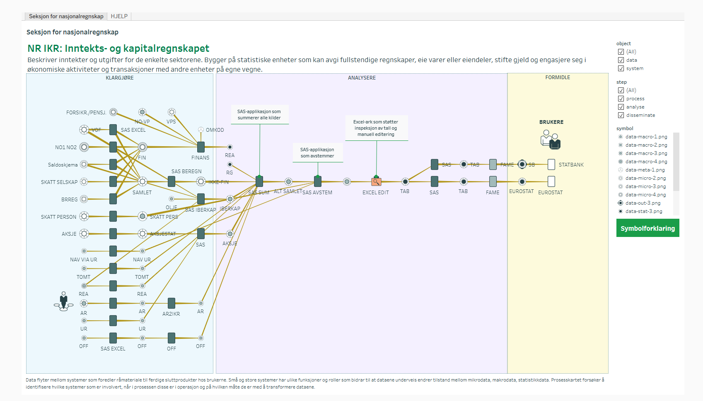
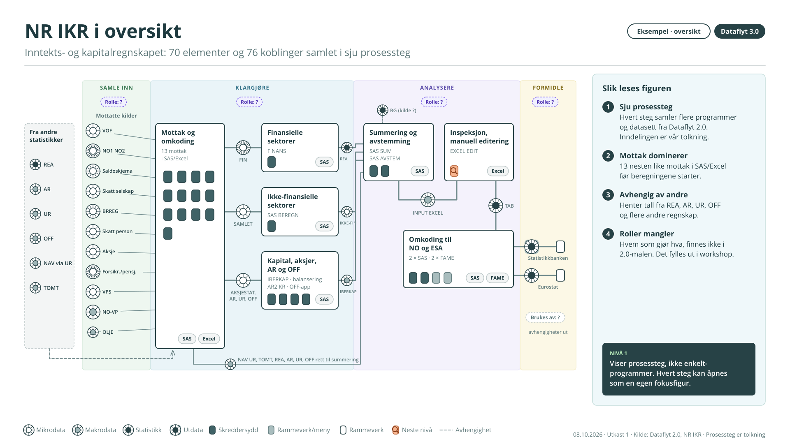
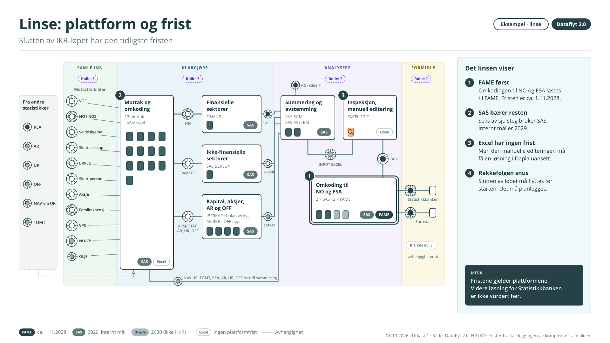
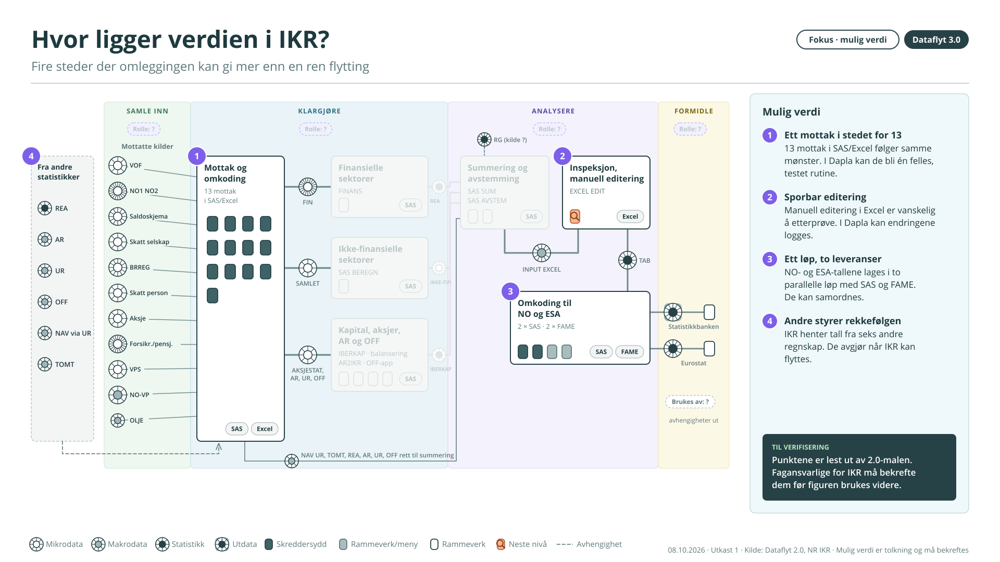
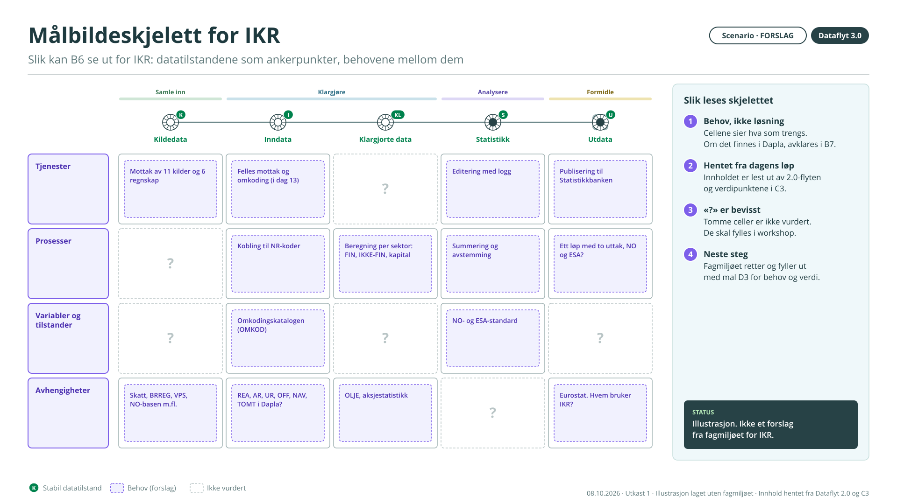
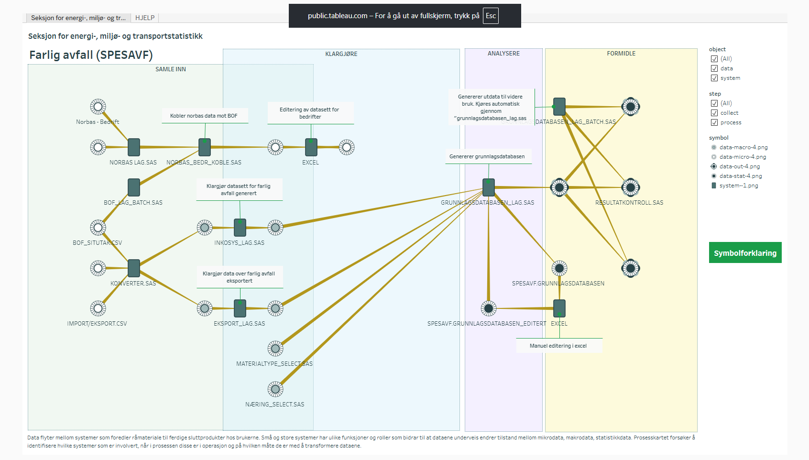

# 6 Eksempel: NR IKR

Nasjonalregnskapets inntekts- og kapitalregnskap (NR IKR) beskriver inntekter og utgifter for de enkelte sektorene i økonomien. Løpet er tegnet i Dataflyt 2.0 og er brukt som første eksempel på Dataflyt 3.0. Det er et godt eksempel fordi det er komplekst: mange kilder, mange parallelle steg, avhengigheter til andre regnskap og manuell editering.

!!! warning "Tolkning, ikke fasit"
    Eksemplet er laget fra Excel-filen i Dataflyt 2.0, uten gjennomgang med fagmiljøet. Inndelingen i prosessteg og de foreslåtte gevinstene er tolkninger som må bekreftes av dem som eier løpet.

## Utgangspunktet: 2.0-tegningen

<figure class="bilde" markdown="span">
  [{ loading=lazy }](bilder/tableau-nr-ikr.png)
  <figcaption>NR IKR i Dataflyt 2.0, tegnet i Tableau fra Excel-malen.</figcaption>
</figure>

Tegningen har 70 elementer (28 systemer og 42 datasett) og 76 koblinger. Den viser hvert program og hvert datasett, men det er vanskelig å se strukturen. Det er også vanskelig å se hva som er viktig for omleggingen. Rollene står ikke i tegningen, og avhengighetene til andre regnskap er tegnet som vanlige kilder.

Figur A2 i [kapittel 1](1-hva-er-dataflyt.md#figur-a2) viser den samme flyten tegnet på nytt fra Excel-filen, med 3.0-symbolene.

## Nivå 1: oversikten

<figure class="figur" id="figur-c1" markdown="span">
  [{ loading=lazy }](figurer/C1.svg)
  <figcaption>Figur C1. NR IKR i oversikt · <a href="figurer/C1.svg" download>Last ned SVG</a></figcaption>
</figure>

De 70 elementene er samlet i sju prosessteg:

1. **Mottak og omkoding** (klargjøre). Tretten nesten like mottak i SAS og Excel, fra elleve kilder og seks andre regnskap.
2. **Finansielle sektorer** (klargjøre). FINANS, med omkodingskatalogen som metadata.
3. **Ikke-finansielle sektorer** (klargjøre). SAS BEREGN.
4. **Kapital, aksjer, AR og OFF** (klargjøre). Fire SAS-programmer.
5. **Summering og avstemming** (analysere). SAS SUM og SAS AVSTEM. Her kommer også RG inn, uten kjent kilde.
6. **Inspeksjon og manuell editering** (analysere). EXCEL EDIT, et regneark der tall inspiseres og rettes for hånd.
7. **Omkoding til NO og ESA** (analysere). To SAS-programmer og to FAME-baser, videre til Statistikkbanken og Eurostat.

Rollene er ikke kartlagt og står som «Rolle: ?». Hvem som bruker IKR, er heller ikke kjent. Begge deler er spørsmål til workshopen.

## Linse: plattform og frist

<figure class="figur" id="figur-c2" markdown="span">
  [{ loading=lazy }](figurer/C2.svg)
  <figcaption>Figur C2. Linse: plattform og frist · <a href="figurer/C2.svg" download>Last ned SVG</a></figcaption>
</figure>

Linsen farger plattformbrikkene etter fristen for bakkesystemet. Seks av sju steg bruker SAS. Det siste steget, omkodingen til NO og ESA, laster til FAME, som har den tidligste fristen. Slutten av løpet må altså flyttes før starten, og det må tas med i planleggingen.

## Hvor ligger verdien?

<figure class="figur" id="figur-c3" markdown="span">
  [{ loading=lazy }](figurer/C3.svg)
  <figcaption>Figur C3. Hvor ligger verdien i IKR? · <a href="figurer/C3.svg" download>Last ned SVG</a></figcaption>
</figure>

Fire steder der omleggingen kan gi mer enn en ren flytting:

1. **Ett mottak i stedet for 13.** Mottakene følger samme mønster. I Dapla kan de bli én felles, testet rutine.
2. **Sporbar editering.** Manuell editering i Excel er vanskelig å etterprøve. I Dapla kan endringene logges.
3. **Ett løp, to leveranser.** NO- og ESA-tallene lages i to parallelle løp. De kan samordnes.
4. **Andre styrer rekkefølgen.** IKR henter tall fra seks andre regnskap. De avgjør når IKR kan flyttes.

Punktene er lest ut av 2.0-tegningen og er forslag til hva workshopen bør se på.

## Målbildeskjelettet

<figure class="figur" id="figur-c4" markdown="span">
  [{ loading=lazy }](figurer/C4.svg)
  <figcaption>Figur C4. Målbildeskjelett for IKR · <a href="figurer/C4.svg" download>Last ned SVG</a></figcaption>
</figure>

Skjelettet viser hvordan B6 kan se ut for IKR, med de fem datatilstandene som kolonner og behovene i cellene. Innholdet er hentet fra 2.0-flyten og verdipunktene over. De tomme cellene er bevisste: de er ikke vurdert og skal fylles ut i workshopen, med [mal D3](maler/d3.md).

## Til sammenligning: et løp med alle fire fasene

<figure class="bilde" markdown="span">
  [{ loading=lazy }](bilder/tableau-spesavf.png)
  <figcaption>Farlig avfall (SPESAVF) i Dataflyt 2.0. Løpet har alle fire fasene, og samle inn og klargjøre overlapper.</figcaption>
</figure>

IKR har ingen egen innsamling. Alle kildene er data som allerede er samlet inn av andre. Farlig avfall er et eksempel på et løp med alle fire fasene. Det viser også at fasene i praksis overlapper, slik at et strengt fasebånd per element ikke alltid passer. Derfor settes fasen på prosesssteget i 3.0.
