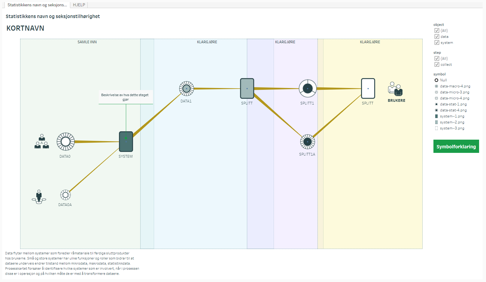

# 7 Verktøy og nedlasting

Dataflyt kan tegnes på tre måter: for hånd på papir, med Excel og Tableau slik som i 2.0, eller med KI-støtte slik som i 3.0. De bruker samme symboler og samme koder, så du kan begynne på én måte og fortsette på en annen.

## Alt til nedlasting

| Fil | Hva | Brukes til |
|---|---|---|
| [dataflyt_mal.xlsx](filer/maler/dataflyt_mal.xlsx) | Excel-malen fra Dataflyt 2.0 | Fylle inn systemer og datasett som Tableau tegner fra |
| [dataflyt_mal.twbx](filer/maler/dataflyt_mal.twbx) | Tableau-malen, med symbolene innebygd | Tegne flyten fra Excel-filen |
| [tableau-symboler.zip](filer/tableau-symboler.zip) | De 24 symbolene som PNG | Installere symbolene i Tableau |
| [dataflyt_eksempel_nr_ikr.xlsx](filer/maler/dataflyt_eksempel_nr_ikr.xlsx) | Utfylt Excel-mal for NR IKR | Eksempel på en kompleks flyt |
| [dataflyt_rutenett_A3_01-10.pdf](filer/maler/dataflyt_rutenett_A3_01-10.pdf) · [11–20](filer/maler/dataflyt_rutenett_A3_11-20.pdf) · [21–30](filer/maler/dataflyt_rutenett_A3_21-30.pdf) | Rutenett i A3 | Tegne for hånd i workshop |
| [symboler-svg.zip](filer/symboler-svg.zip) | Alle 121 symboler som SVG | Tegne selv, i PowerPoint, Illustrator eller kode |
| [ssb-dataflyt.zip](filer/skills/ssb-dataflyt.zip) · [SKILL.md](filer/skills/ssb-dataflyt/SKILL.md) | Skillen ssb-dataflyt | KI-støtte til kartlegging og tegning |
| [ssb-konseptfigurer.zip](filer/skills/ssb-konseptfigurer.zip) · [SKILL.md](filer/skills/ssb-konseptfigurer/SKILL.md) | Skillen ssb-konseptfigurer | Formfaktor, farger og regler for figurene |
| [Malene D1–D3](maler/index.md) | Utfyllbare maler på nett | Kartlegge og lage tekst til skillen |

## Excel-malen

<figure class="bilde" markdown="span">
  [{ loading=lazy }](bilder/dataflyt-2-0-tableau-mal.png)
  <figcaption>Malen i Tableau, tegnet fra et lite eksempel i Excel-malen. Eksemplet viser en split, der ett datasett går videre til to systemer.</figcaption>
</figure>

Excel-malen har tre ark:

- **`kortnavn`** er arket du fyller ut. Gi det gjerne nytt navn etter statistikkens kortnavn.
- **`hjelp`** forklarer hvert felt, og om det skal fylles ut eller regnes ut.
- **`lists`** har verdiene som er lov i hvert felt. Feltene i `kortnavn` har nedtrekkslister som henter fra dette arket.

Slik fyller du den ut:

1. **Lagre en kopi** med navnet `dataflyt_<kortnavn>.xlsx`.
2. **Fyll ut én rad per system eller datasett**, i de hvite feltene: `coord`, `next`, `step`, `object`, `data` eller `system`, `name`, `desc`, `data_rows` og `data_cols`. Feltene er forklart i [kapittel 4](4-datamodellen.md#feltene-du-fyller-ut).
3. **Kopier formelraden.** Hvert element står på to rader. Den andre raden, med `line` i `mark`, lages av formler. Kopier begge radene nedover når du legger til et element.
4. **Ved split dupliserer du raden** én gang per element flyten skal videre til, med ulik `next`.
5. **Endre ikke de grå feltene.** De regnes ut.

Formlene bruker funksjonene `TEXTBEFORE` og `TEXTAFTER`. De finnes i nyere versjoner av Excel. I eldre versjoner vises en feilmelding i kolonnene `X-line` og `Y-line`.

Malen bruker engelske koder (`collect`, `micro`, `system` og så videre). De er de samme i 3.0, så en utfylt Excel-fil kan leses inn i den nye modellen.

## Tableau-malen

Tableau-malen tegner flyten fra Excel-filen. Den har tre faner:

- **KORTNAVN** er selve tegningen. Den bruker to akser: én med streker (`X-line`, `Y-line`), der tykkelsen følger `line`, og én med symboler (`X-shp`, `Y-line`), der formen følger `symbol` og størrelsen `data_rows`. Navnet står som etikett, og beskrivelsen vises når man holder musepekeren over.
- **Statistikkens navn og seksjonstilhørighet** er dashbordet. Det har fasebåndene som tekstbokser, filter for `object` og `step`, symbolforklaringen og ikoner for kilder og brukere.
- **HJELP** viser symbolforklaringen.

Slik lager du en ny tegning:

1. **Åpne `dataflyt_mal.twbx`** i Tableau Desktop eller Tableau Public.
2. **Bytt datakilde** til din egen Excel-fil: *Data → Erstatt datakilde*, og velg arket du har fylt ut.
3. **Juster aksene.** Malen har faste akser (X fra 0 til 7, Y fra −4 til 0), tilpasset eksemplet. Utvid dem til koordinatene i din flyt.
4. **Flytt fasebåndene.** De er tekstbokser på dashbordet og må plasseres for hånd, slik at de passer med `step`.
5. **Skriv tittel og seksjon** i tittelfeltet, og fest eventuelle forklaringsbokser til de viktigste symbolene.
6. **Publiser eller eksporter.** Tableau Public er åpent for alle. Publiser ikke tegninger som viser interne forhold. Bruk heller utskrift, PDF eller bilde.

Symbolene er innebygd i arbeidsboken. Vil du bruke dem i en ny arbeidsbok, pakker du ut [tableau-symboler.zip](filer/tableau-symboler.zip) til en mappe som heter `Data flow` under *Mine Tableau-repositorier → Former* (*My Tableau Repository → Shapes*), og starter Tableau på nytt. Filnavnene må stå som de er, fordi kolonnen `symbol` i Excel-malen viser til dem.

Tegningene fra 2.0 har okergule streker (`#b3971c`), som i 1.0. Tegningene fra 3.0 bruker SSBs farger.

Malen ligger også på Tableau Public: [dataflyt_mal](https://public.tableau.com/views/dataflyt_mal/Statistikkensnavnogseksjonstilhrighet). Utenrikshandel med varer er et eksempel på en ferdig tegning: [dataflyt_uhv](https://public.tableau.com/views/dataflyt_uhv/Dataflytistatistikkproduksjon).

## A3-maler til workshop

Tre rutenett i A3 stående, til å tegne flyten for hånd:

- [Koordinat 1–10](filer/maler/dataflyt_rutenett_A3_01-10.pdf)
- [Koordinat 11–20](filer/maler/dataflyt_rutenett_A3_11-20.pdf)
- [Koordinat 21–30](filer/maler/dataflyt_rutenett_A3_21-30.pdf)

Tallene langs kantene er de samme som i `coord` i Excel-malen. Plasser datasettene og systemene der linjene krysser, og les av koordinatene når tegningen skal overføres. Lange løp fortsetter på neste ark.

Start gjerne med å identifisere systemene og datasettene i en liste før dere plotter dem inn i rutenettet. Mal D1 og D2 kan skrives ut og brukes til det.

## KI-støtte: skillen ssb-dataflyt { #ki-stotte }

Skillen **ssb-dataflyt** er en samling instruksjoner som lærer Claude å kartlegge og tegne dataflyt etter metoden på disse sidene. Den bygger på skillen **ssb-konseptfigurer**, som gir formfaktor, farger og regler for figurene.

### Hva skillen gjør

Skillen har tre arbeidsmåter:

| Arbeidsmåte | Du gir | Du får |
|---|---|---|
| **A Lese inn** | En Excel-fil fra Dataflyt 2.0, og gjerne skjermbilder fra Tableau | Modell, kontrolltegning av hele flyten, forslag til prosessteg (nivå 1) og spørsmålsliste |
| **B Kartlegge** | Tekst fra malene D1–D3, notater fra workshopen, utfylte B5 og B6 | Oppdatert modell, oppfølgingsspørsmål ett om gangen, nye tegninger |
| **C Tegne** | En modell som allerede finnes | Nivå 1–3, linser, målbildeskjelett, tomme maler |

Hver leveranse har en modellfil (YAML), tegninger som SVG i 16:9 og en kvalitetssikringsliste fordelt på hvem som må bekrefte.

### Slik tar du den i bruk

1. **Last ned [ssb-dataflyt.zip](filer/skills/ssb-dataflyt.zip)** og, hvis du ikke har den fra før, [ssb-konseptfigurer.zip](filer/skills/ssb-konseptfigurer.zip).
2. **Last dem opp som skills i Claude** under innstillingene for skills.
3. **Fyll ut malene** og trykk **Lag tekst til skillen** på [oversikten](maler/index.md#svarene-dine).
4. **Start en ny samtale,** lim inn teksten, og legg ved Excel-filen fra 2.0 hvis den finnes.
5. **Svar på spørsmålene** skillen stiller, og be om de tegningene du trenger.

Teksten fra malene er laget for skillen, men den er vanlig tekst. Du kan lese den, rette den og legge til før du limer den inn.

### Hva du bør være klar over

- **Følg SSBs retningslinjer for bruk av KI.** Malene handler om systemer og datasett, ikke om personer eller tall. Skriv ikke inn personopplysninger, upubliserte tall eller tilgangsinformasjon.
- **Resultatet er et utkast.** Skillen merker det den har tolket, og fagmiljøet må bekrefte før tegningene brukes videre.
- **Tegningene kan variere litt** fra gang til gang, fordi koden for tegning skrives på nytt i hver samtale. Modellfilen er det som holder resultatet stabilt. Ta vare på den, og gi den til skillen neste gang.

## Endre malene på disse sidene

Malene D1–D3 bygges av skriptet `verktoy/bygg_maler.py` i repoet. Hvert felt har en fast nøkkel. Endres nøklene etter at malene er tatt i bruk, finner ikke nettleseren igjen svarene brukerne har skrevet.
