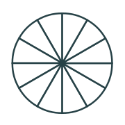

# Grafiske elementer

Alle symbolene i Dataflyt som SVG. Klikk på et symbol for å åpne det, eller last ned [alle symbolene samlet (zip)](filer/symboler-svg.zip). Betydningen er forklart i [kapittel 2](2-symbolspraket.md). Symbolene til Tableau-malen ligger som PNG i [tableau-symboler.zip](filer/tableau-symboler.zip).

## Slik er filene navngitt

Datasymbolene heter `<type>-data-<eiker>-<størrelse>.svg`, for eksempel `makro-data-08-2.svg`:

| Del | Verdier | Betyr |
|---|---|---|
| Type | `meta`, `mikro-data`, `makro-data`, `stat-data`, `stat-prod-smpl`, `stat-prod-kompleks`, `stat-prod-prioritet`, `mikro-prod-smpl` | Datatype og type sluttprodukt |
| Eiker | `00`, `03`, `08`, `12`, `20` | Antall eiker. `03`–`20` svarer til variabler 1–4 i Excel-malen. `00` er uten eiker |
| Størrelse | `1`, `2`, `3` | Mengde rader: lite, middels, mye |

Styringsdata heter `styring-data-<fase>-<størrelse>.svg`, og systemene `system-black` (skreddersydd kode), `system-grey` (rammeverk med meny), `system-white` (rammeverk) og `system-focus` (avanserte løsninger, neste nivå).

## Metadata

Kodelister, kataloger og annen beskrivelse. Bare eiker, ingen kjerne.

<a href="symboler/meta-03-1.svg" title="meta-03-1">meta-03-1</a>
<a href="symboler/meta-03-2.svg" title="meta-03-2">meta-03-2</a>
<a href="symboler/meta-03-3.svg" title="meta-03-3">meta-03-3</a>
<a href="symboler/meta-08-1.svg" title="meta-08-1">meta-08-1</a>
<a href="symboler/meta-08-2.svg" title="meta-08-2">meta-08-2</a>
<a href="symboler/meta-08-3.svg" title="meta-08-3">meta-08-3</a>
<a href="symboler/meta-12-1.svg" title="meta-12-1">meta-12-1</a>
<a href="symboler/meta-12-2.svg" title="meta-12-2">meta-12-2</a>
<a href="symboler/meta-12-3.svg" title="meta-12-3">meta-12-3</a>
<a href="symboler/meta-20-1.svg" title="meta-20-1">meta-20-1</a>
<a href="symboler/meta-20-2.svg" title="meta-20-2">meta-20-2</a>
<a href="symboler/meta-20-3.svg" title="meta-20-3">meta-20-3</a>

## Mikrodata

Opplysninger om enkeltenheter. Hvit kjerne.

<a href="symboler/mikro-data-00-1.svg" title="mikro-data-00-1">mikro-data-00-1</a>
<a href="symboler/mikro-data-00-2.svg" title="mikro-data-00-2">mikro-data-00-2</a>
<a href="symboler/mikro-data-00-3.svg" title="mikro-data-00-3">mikro-data-00-3</a>
<a href="symboler/mikro-data-03-1.svg" title="mikro-data-03-1">mikro-data-03-1</a>
<a href="symboler/mikro-data-03-2.svg" title="mikro-data-03-2">mikro-data-03-2</a>
<a href="symboler/mikro-data-03-3.svg" title="mikro-data-03-3">mikro-data-03-3</a>
<a href="symboler/mikro-data-08-1.svg" title="mikro-data-08-1">mikro-data-08-1</a>
<a href="symboler/mikro-data-08-2.svg" title="mikro-data-08-2">mikro-data-08-2</a>
<a href="symboler/mikro-data-08-3.svg" title="mikro-data-08-3">mikro-data-08-3</a>
<a href="symboler/mikro-data-12-1.svg" title="mikro-data-12-1">mikro-data-12-1</a>
<a href="symboler/mikro-data-12-2.svg" title="mikro-data-12-2">mikro-data-12-2</a>
<a href="symboler/mikro-data-12-3.svg" title="mikro-data-12-3">mikro-data-12-3</a>
<a href="symboler/mikro-data-20-1.svg" title="mikro-data-20-1">mikro-data-20-1</a>
<a href="symboler/mikro-data-20-2.svg" title="mikro-data-20-2">mikro-data-20-2</a>
<a href="symboler/mikro-data-20-3.svg" title="mikro-data-20-3">mikro-data-20-3</a>

## Makrodata

Delvis aggregerte data. Grågrønn kjerne.

<a href="symboler/makro-data-00-1.svg" title="makro-data-00-1">makro-data-00-1</a>
<a href="symboler/makro-data-00-2.svg" title="makro-data-00-2">makro-data-00-2</a>
<a href="symboler/makro-data-00-3.svg" title="makro-data-00-3">makro-data-00-3</a>
<a href="symboler/makro-data-03-1.svg" title="makro-data-03-1">makro-data-03-1</a>
<a href="symboler/makro-data-03-2.svg" title="makro-data-03-2">makro-data-03-2</a>
<a href="symboler/makro-data-03-3.svg" title="makro-data-03-3">makro-data-03-3</a>
<a href="symboler/makro-data-08-1.svg" title="makro-data-08-1">makro-data-08-1</a>
<a href="symboler/makro-data-08-2.svg" title="makro-data-08-2">makro-data-08-2</a>
<a href="symboler/makro-data-08-3.svg" title="makro-data-08-3">makro-data-08-3</a>
<a href="symboler/makro-data-12-1.svg" title="makro-data-12-1">makro-data-12-1</a>
<a href="symboler/makro-data-12-2.svg" title="makro-data-12-2">makro-data-12-2</a>
<a href="symboler/makro-data-12-3.svg" title="makro-data-12-3">makro-data-12-3</a>
<a href="symboler/makro-data-20-1.svg" title="makro-data-20-1">makro-data-20-1</a>
<a href="symboler/makro-data-20-2.svg" title="makro-data-20-2">makro-data-20-2</a>
<a href="symboler/makro-data-20-3.svg" title="makro-data-20-3">makro-data-20-3</a>

## Statistikk

Ferdig aggregert statistikk, ikke publisert. Mørk kjerne.

<a href="symboler/stat-data-00-1.svg" title="stat-data-00-1">stat-data-00-1</a>
<a href="symboler/stat-data-00-2.svg" title="stat-data-00-2">stat-data-00-2</a>
<a href="symboler/stat-data-00-3.svg" title="stat-data-00-3">stat-data-00-3</a>
<a href="symboler/stat-data-03-1.svg" title="stat-data-03-1">stat-data-03-1</a>
<a href="symboler/stat-data-03-2.svg" title="stat-data-03-2">stat-data-03-2</a>
<a href="symboler/stat-data-03-3.svg" title="stat-data-03-3">stat-data-03-3</a>
<a href="symboler/stat-data-08-1.svg" title="stat-data-08-1">stat-data-08-1</a>
<a href="symboler/stat-data-08-2.svg" title="stat-data-08-2">stat-data-08-2</a>
<a href="symboler/stat-data-08-3.svg" title="stat-data-08-3">stat-data-08-3</a>
<a href="symboler/stat-data-12-1.svg" title="stat-data-12-1">stat-data-12-1</a>
<a href="symboler/stat-data-12-2.svg" title="stat-data-12-2">stat-data-12-2</a>
<a href="symboler/stat-data-12-3.svg" title="stat-data-12-3">stat-data-12-3</a>
<a href="symboler/stat-data-20-1.svg" title="stat-data-20-1">stat-data-20-1</a>
<a href="symboler/stat-data-20-2.svg" title="stat-data-20-2">stat-data-20-2</a>
<a href="symboler/stat-data-20-3.svg" title="stat-data-20-3">stat-data-20-3</a>

## Utdata: enkelt sluttprodukt

Formidlet statistikk med relativt enkelt innhold. Mørke blader.

<a href="symboler/stat-prod-smpl-03-1.svg" title="stat-prod-smpl-03-1">stat-prod-smpl-03-1</a>
<a href="symboler/stat-prod-smpl-03-2.svg" title="stat-prod-smpl-03-2">stat-prod-smpl-03-2</a>
<a href="symboler/stat-prod-smpl-03-3.svg" title="stat-prod-smpl-03-3">stat-prod-smpl-03-3</a>
<a href="symboler/stat-prod-smpl-08-1.svg" title="stat-prod-smpl-08-1">stat-prod-smpl-08-1</a>
<a href="symboler/stat-prod-smpl-08-2.svg" title="stat-prod-smpl-08-2">stat-prod-smpl-08-2</a>
<a href="symboler/stat-prod-smpl-08-3.svg" title="stat-prod-smpl-08-3">stat-prod-smpl-08-3</a>
<a href="symboler/stat-prod-smpl-12-1.svg" title="stat-prod-smpl-12-1">stat-prod-smpl-12-1</a>
<a href="symboler/stat-prod-smpl-12-2.svg" title="stat-prod-smpl-12-2">stat-prod-smpl-12-2</a>
<a href="symboler/stat-prod-smpl-12-3.svg" title="stat-prod-smpl-12-3">stat-prod-smpl-12-3</a>
<a href="symboler/stat-prod-smpl-20-1.svg" title="stat-prod-smpl-20-1">stat-prod-smpl-20-1</a>
<a href="symboler/stat-prod-smpl-20-2.svg" title="stat-prod-smpl-20-2">stat-prod-smpl-20-2</a>
<a href="symboler/stat-prod-smpl-20-3.svg" title="stat-prod-smpl-20-3">stat-prod-smpl-20-3</a>

## Utdata: avansert sluttprodukt

Formidlet statistikk med mer sammensatt innhold. Grågrønne blader.

<a href="symboler/stat-prod-kompleks-03-1.svg" title="stat-prod-kompleks-03-1">stat-prod-kompleks-03-1</a>
<a href="symboler/stat-prod-kompleks-03-2.svg" title="stat-prod-kompleks-03-2">stat-prod-kompleks-03-2</a>
<a href="symboler/stat-prod-kompleks-03-3.svg" title="stat-prod-kompleks-03-3">stat-prod-kompleks-03-3</a>
<a href="symboler/stat-prod-kompleks-08-1.svg" title="stat-prod-kompleks-08-1">stat-prod-kompleks-08-1</a>
<a href="symboler/stat-prod-kompleks-08-2.svg" title="stat-prod-kompleks-08-2">stat-prod-kompleks-08-2</a>
<a href="symboler/stat-prod-kompleks-08-3.svg" title="stat-prod-kompleks-08-3">stat-prod-kompleks-08-3</a>
<a href="symboler/stat-prod-kompleks-12-1.svg" title="stat-prod-kompleks-12-1">stat-prod-kompleks-12-1</a>
<a href="symboler/stat-prod-kompleks-12-2.svg" title="stat-prod-kompleks-12-2">stat-prod-kompleks-12-2</a>
<a href="symboler/stat-prod-kompleks-12-3.svg" title="stat-prod-kompleks-12-3">stat-prod-kompleks-12-3</a>
<a href="symboler/stat-prod-kompleks-20-1.svg" title="stat-prod-kompleks-20-1">stat-prod-kompleks-20-1</a>
<a href="symboler/stat-prod-kompleks-20-2.svg" title="stat-prod-kompleks-20-2">stat-prod-kompleks-20-2</a>
<a href="symboler/stat-prod-kompleks-20-3.svg" title="stat-prod-kompleks-20-3">stat-prod-kompleks-20-3</a>

## Utdata: prioritert sluttprodukt

Framhevet og sammensatt innhold. Røde og oransje blader.

<a href="symboler/stat-prod-prioritet-03-1.svg" title="stat-prod-prioritet-03-1">stat-prod-prioritet-03-1</a>
<a href="symboler/stat-prod-prioritet-03-2.svg" title="stat-prod-prioritet-03-2">stat-prod-prioritet-03-2</a>
<a href="symboler/stat-prod-prioritet-03-3.svg" title="stat-prod-prioritet-03-3">stat-prod-prioritet-03-3</a>
<a href="symboler/stat-prod-prioritet-08-1.svg" title="stat-prod-prioritet-08-1">stat-prod-prioritet-08-1</a>
<a href="symboler/stat-prod-prioritet-08-2.svg" title="stat-prod-prioritet-08-2">stat-prod-prioritet-08-2</a>
<a href="symboler/stat-prod-prioritet-08-3.svg" title="stat-prod-prioritet-08-3">stat-prod-prioritet-08-3</a>
<a href="symboler/stat-prod-prioritet-12-1.svg" title="stat-prod-prioritet-12-1">stat-prod-prioritet-12-1</a>
<a href="symboler/stat-prod-prioritet-12-2.svg" title="stat-prod-prioritet-12-2">stat-prod-prioritet-12-2</a>
<a href="symboler/stat-prod-prioritet-12-3.svg" title="stat-prod-prioritet-12-3">stat-prod-prioritet-12-3</a>
<a href="symboler/stat-prod-prioritet-20-1.svg" title="stat-prod-prioritet-20-1">stat-prod-prioritet-20-1</a>
<a href="symboler/stat-prod-prioritet-20-2.svg" title="stat-prod-prioritet-20-2">stat-prod-prioritet-20-2</a>
<a href="symboler/stat-prod-prioritet-20-3.svg" title="stat-prod-prioritet-20-3">stat-prod-prioritet-20-3</a>

## Utdata: mikrodata som produkt

Mikrodata som leveres ut. Mørke blader rundt hvit kjerne.

<a href="symboler/mikro-prod-smpl-03-1.svg" title="mikro-prod-smpl-03-1">mikro-prod-smpl-03-1</a>
<a href="symboler/mikro-prod-smpl-03-2.svg" title="mikro-prod-smpl-03-2">mikro-prod-smpl-03-2</a>
<a href="symboler/mikro-prod-smpl-03-3.svg" title="mikro-prod-smpl-03-3">mikro-prod-smpl-03-3</a>
<a href="symboler/mikro-prod-smpl-08-1.svg" title="mikro-prod-smpl-08-1">mikro-prod-smpl-08-1</a>
<a href="symboler/mikro-prod-smpl-08-2.svg" title="mikro-prod-smpl-08-2">mikro-prod-smpl-08-2</a>
<a href="symboler/mikro-prod-smpl-08-3.svg" title="mikro-prod-smpl-08-3">mikro-prod-smpl-08-3</a>
<a href="symboler/mikro-prod-smpl-12-1.svg" title="mikro-prod-smpl-12-1">mikro-prod-smpl-12-1</a>
<a href="symboler/mikro-prod-smpl-12-2.svg" title="mikro-prod-smpl-12-2">mikro-prod-smpl-12-2</a>
<a href="symboler/mikro-prod-smpl-12-3.svg" title="mikro-prod-smpl-12-3">mikro-prod-smpl-12-3</a>
<a href="symboler/mikro-prod-smpl-20-1.svg" title="mikro-prod-smpl-20-1">mikro-prod-smpl-20-1</a>
<a href="symboler/mikro-prod-smpl-20-2.svg" title="mikro-prod-smpl-20-2">mikro-prod-smpl-20-2</a>
<a href="symboler/mikro-prod-smpl-20-3.svg" title="mikro-prod-smpl-20-3">mikro-prod-smpl-20-3</a>

## Styringsdata

Styringsdata og andre data som oppstår underveis, i fasefargene.

<a href="symboler/styring-data-analysere-1.svg" title="styring-data-analysere-1">styring-data-analysere-1</a>
<a href="symboler/styring-data-analysere-2.svg" title="styring-data-analysere-2">styring-data-analysere-2</a>
<a href="symboler/styring-data-analysere-3.svg" title="styring-data-analysere-3">styring-data-analysere-3</a>
<a href="symboler/styring-data-formidle-1.svg" title="styring-data-formidle-1">styring-data-formidle-1</a>
<a href="symboler/styring-data-formidle-2.svg" title="styring-data-formidle-2">styring-data-formidle-2</a>
<a href="symboler/styring-data-formidle-3.svg" title="styring-data-formidle-3">styring-data-formidle-3</a>
<a href="symboler/styring-data-klargjore-1.svg" title="styring-data-klargjore-1">styring-data-klargjore-1</a>
<a href="symboler/styring-data-klargjore-2.svg" title="styring-data-klargjore-2">styring-data-klargjore-2</a>
<a href="symboler/styring-data-klargjore-3.svg" title="styring-data-klargjore-3">styring-data-klargjore-3</a>
<a href="symboler/styring-data-samleinn-1.svg" title="styring-data-samleinn-1">styring-data-samleinn-1</a>
<a href="symboler/styring-data-samleinn-2.svg" title="styring-data-samleinn-2">styring-data-samleinn-2</a>
<a href="symboler/styring-data-samleinn-3.svg" title="styring-data-samleinn-3">styring-data-samleinn-3</a>

## System

Systemtypene, og fokus (lupe) for løsninger som kan åpnes på et neste nivå.

<a href="symboler/system-black.svg" title="system-black">system-black</a>
<a href="symboler/system-focus.svg" title="system-focus">system-focus</a>
<a href="symboler/system-grey.svg" title="system-grey">system-grey</a>
<a href="symboler/system-white.svg" title="system-white">system-white</a>

