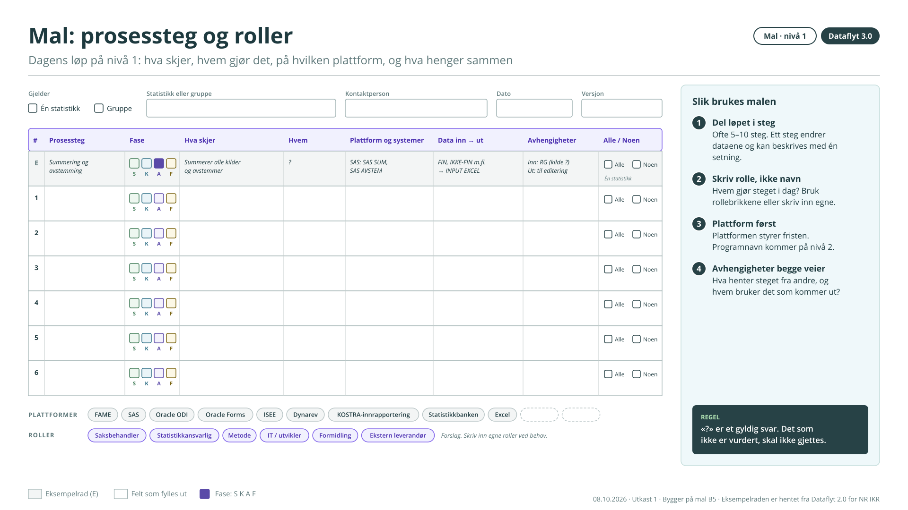

# Mal D1: Prosessteg og roller

Dagens løp på nivå 1: hva som skjer, hvem som gjør det, på hvilken plattform og hva som henger sammen. Malen bygger på [figur D1](../5-slik-kartlegger-du.md#figur-d1).

!!! info "Slik fyller du ut"

    1. **Fyll ut feltene om statistikken.** De følger med på alle malene.
    2. **Del løpet i steg** fra innsamling til formidling. Skriv rolle, ikke navn.
    3. **Plattform først.** Programnavn kommer i mal D2.
    4. **Skriv «?»** der du ikke vet. Det er et gyldig svar.

    Svarene lagres bare i denne nettleseren. Når du er ferdig, trykker du **Lag tekst til skillen** og kopierer teksten inn i Claude. Du kan også laste ned svarene eller ta en sikkerhetskopi fra [oversikten](index.md#svarene-dine).

<button type="button" class="md-button md-button--primary" data-gjor="skill">Lag tekst til skillen</button><button type="button" class="md-button" data-gjor="kopier">Kopier svarene</button><button type="button" class="md-button" data-gjor="lastned">Last ned (.md)</button><button type="button" class="md-button" data-gjor="skrivut">Skriv ut</button><button type="button" class="md-button ark-tom" data-gjor="tom">Tøm malen</button>

Tekst til skillen ssb-dataflyt. Kopier den inn i en samtale med Claude, gjerne sammen med en eventuell 2.0-fil i Excel.
<textarea readonly rows="8" aria-label="Tekst til skillen"></textarea><button type="button" class="md-button" data-gjor="kopierskill">Kopier teksten</button>
<form class="ark-skjema" onsubmit="return false"><datalist id="plattformer"><option value="FAME"><option value="SAS"><option value="Oracle ODI"><option value="Oracle Forms"><option value="ISEE"><option value="Dynarev"><option value="KOSTRA-innrapportering"><option value="Statistikkbanken"><option value="Excel"><option value="R"><option value="Python"><option value="Dapla"></datalist><datalist id="roller"><option value="saksbehandler"><option value="statistikkansvarlig"><option value="metode"><option value="IT/utvikler"><option value="formidling"><option value="ekstern leverandør"></datalist><section class="ark-del ark-felles-del"><h3>Om statistikken (følger med på alle malene)</h3>
<label class="ark-felt">Statistikk<input type="text" data-k="felles.statistikk" data-l="Statistikk" placeholder="Eksempel: Inntekts- og kapitalregnskapet" class=""></label><label class="ark-felt">Kortnavn<input type="text" data-k="felles.kortnavn" data-l="Kortnavn" placeholder="Eksempel: NR IKR" class=""></label><label class="ark-felt">Seksjon<input type="text" data-k="felles.seksjon" data-l="Seksjon" placeholder="Eksempel: Seksjon for nasjonalregnskap" class=""></label><label class="ark-felt">Kontaktperson<input type="text" data-k="felles.kontakt" data-l="Kontaktperson" placeholder="Rolle eller navn" class=""></label>

<label class="ark-felt">Gjelder malen én statistikk eller en gruppe?<select data-k="felles.gjelder" data-l="Gjelder" class=""><option value=""></option><option value="en">Én statistikk</option><option value="gruppe">En gruppe statistikker</option></select></label><label class="ark-felt">Statistikker i gruppen<input type="text" data-k="felles.gruppe" data-l="Statistikker i gruppen" placeholder="Bare for grupper: kortnavn eller initialer" class=""></label><label class="ark-felt">Dato<input type="text" data-k="felles.dato" data-l="Dato" placeholder="Eksempel: 19.11.2026" class=""></label>
</section><section class="ark-del "><h3>Prosessteg i rekkefølge</h3>
Ett steg endrer dataene og kan beskrives med én setning. Ofte 5–10 steg. Første rad viser et eksempel fra NR IKR.

<table class="ark-t" data-liste="_liste.D1"><thead><tr><th>#</th><th>Prosessteg</th><th>Fase</th><th>Hva skjer</th><th>Hvem (rolle)</th><th>Plattform og systemer</th><th>Data inn → ut</th><th>Avhengigheter</th><th>Alle / noen</th></tr></thead><tbody><tr><td class="ark-nr">1</td><td style="min-width:11em"><input type="text" data-k="D1.steg.1.navn" data-l="Prosessteg" placeholder="Summering og avstemming" class=""></td><td style="min-width:8em"><select data-k="D1.steg.1.fase" data-l="Fase" class=""><option value=""></option><option value="samle">Samle inn</option><option value="klargj">Klargjøre</option><option value="analyse">Analysere</option><option value="formidle">Formidle</option><option value="flere">Flere faser</option><option value="?">?</option></select></td><td style="min-width:14em"><textarea data-k="D1.steg.1.hva" data-l="Hva skjer" rows="1" placeholder="Summerer alle kilder og avstemmer"></textarea></td><td style="min-width:9em"><input type="text" data-k="D1.steg.1.rolle" data-l="Hvem (rolle)" placeholder="?" list="roller" class=""></td><td style="min-width:11em"><input type="text" data-k="D1.steg.1.plattform" data-l="Plattform og systemer" placeholder="SAS" list="plattformer" class=""></td><td style="min-width:12em"><textarea data-k="D1.steg.1.data" data-l="Data inn → ut" rows="1" placeholder="FIN, IKKE-FIN → INPUT EXCEL"></textarea></td><td style="min-width:11em"><textarea data-k="D1.steg.1.avh" data-l="Avhengigheter" rows="1" placeholder="Inn: RG (kilde ?)"></textarea></td><td style="min-width:6em"><select data-k="D1.steg.1.gjelder" data-l="Alle / noen" class=""><option value=""></option><option value="alle">Alle</option><option value="noen">Noen</option><option value="?">?</option></select></td></tr><tr><td class="ark-nr">2</td><td style="min-width:11em"><input type="text" data-k="D1.steg.2.navn" data-l="Prosessteg" class=""></td><td style="min-width:8em"><select data-k="D1.steg.2.fase" data-l="Fase" class=""><option value=""></option><option value="samle">Samle inn</option><option value="klargj">Klargjøre</option><option value="analyse">Analysere</option><option value="formidle">Formidle</option><option value="flere">Flere faser</option><option value="?">?</option></select></td><td style="min-width:14em"><textarea data-k="D1.steg.2.hva" data-l="Hva skjer" rows="1"></textarea></td><td style="min-width:9em"><input type="text" data-k="D1.steg.2.rolle" data-l="Hvem (rolle)" list="roller" class=""></td><td style="min-width:11em"><input type="text" data-k="D1.steg.2.plattform" data-l="Plattform og systemer" list="plattformer" class=""></td><td style="min-width:12em"><textarea data-k="D1.steg.2.data" data-l="Data inn → ut" rows="1"></textarea></td><td style="min-width:11em"><textarea data-k="D1.steg.2.avh" data-l="Avhengigheter" rows="1"></textarea></td><td style="min-width:6em"><select data-k="D1.steg.2.gjelder" data-l="Alle / noen" class=""><option value=""></option><option value="alle">Alle</option><option value="noen">Noen</option><option value="?">?</option></select></td></tr><tr><td class="ark-nr">3</td><td style="min-width:11em"><input type="text" data-k="D1.steg.3.navn" data-l="Prosessteg" class=""></td><td style="min-width:8em"><select data-k="D1.steg.3.fase" data-l="Fase" class=""><option value=""></option><option value="samle">Samle inn</option><option value="klargj">Klargjøre</option><option value="analyse">Analysere</option><option value="formidle">Formidle</option><option value="flere">Flere faser</option><option value="?">?</option></select></td><td style="min-width:14em"><textarea data-k="D1.steg.3.hva" data-l="Hva skjer" rows="1"></textarea></td><td style="min-width:9em"><input type="text" data-k="D1.steg.3.rolle" data-l="Hvem (rolle)" list="roller" class=""></td><td style="min-width:11em"><input type="text" data-k="D1.steg.3.plattform" data-l="Plattform og systemer" list="plattformer" class=""></td><td style="min-width:12em"><textarea data-k="D1.steg.3.data" data-l="Data inn → ut" rows="1"></textarea></td><td style="min-width:11em"><textarea data-k="D1.steg.3.avh" data-l="Avhengigheter" rows="1"></textarea></td><td style="min-width:6em"><select data-k="D1.steg.3.gjelder" data-l="Alle / noen" class=""><option value=""></option><option value="alle">Alle</option><option value="noen">Noen</option><option value="?">?</option></select></td></tr><tr><td class="ark-nr">4</td><td style="min-width:11em"><input type="text" data-k="D1.steg.4.navn" data-l="Prosessteg" class=""></td><td style="min-width:8em"><select data-k="D1.steg.4.fase" data-l="Fase" class=""><option value=""></option><option value="samle">Samle inn</option><option value="klargj">Klargjøre</option><option value="analyse">Analysere</option><option value="formidle">Formidle</option><option value="flere">Flere faser</option><option value="?">?</option></select></td><td style="min-width:14em"><textarea data-k="D1.steg.4.hva" data-l="Hva skjer" rows="1"></textarea></td><td style="min-width:9em"><input type="text" data-k="D1.steg.4.rolle" data-l="Hvem (rolle)" list="roller" class=""></td><td style="min-width:11em"><input type="text" data-k="D1.steg.4.plattform" data-l="Plattform og systemer" list="plattformer" class=""></td><td style="min-width:12em"><textarea data-k="D1.steg.4.data" data-l="Data inn → ut" rows="1"></textarea></td><td style="min-width:11em"><textarea data-k="D1.steg.4.avh" data-l="Avhengigheter" rows="1"></textarea></td><td style="min-width:6em"><select data-k="D1.steg.4.gjelder" data-l="Alle / noen" class=""><option value=""></option><option value="alle">Alle</option><option value="noen">Noen</option><option value="?">?</option></select></td></tr><tr><td class="ark-nr">5</td><td style="min-width:11em"><input type="text" data-k="D1.steg.5.navn" data-l="Prosessteg" class=""></td><td style="min-width:8em"><select data-k="D1.steg.5.fase" data-l="Fase" class=""><option value=""></option><option value="samle">Samle inn</option><option value="klargj">Klargjøre</option><option value="analyse">Analysere</option><option value="formidle">Formidle</option><option value="flere">Flere faser</option><option value="?">?</option></select></td><td style="min-width:14em"><textarea data-k="D1.steg.5.hva" data-l="Hva skjer" rows="1"></textarea></td><td style="min-width:9em"><input type="text" data-k="D1.steg.5.rolle" data-l="Hvem (rolle)" list="roller" class=""></td><td style="min-width:11em"><input type="text" data-k="D1.steg.5.plattform" data-l="Plattform og systemer" list="plattformer" class=""></td><td style="min-width:12em"><textarea data-k="D1.steg.5.data" data-l="Data inn → ut" rows="1"></textarea></td><td style="min-width:11em"><textarea data-k="D1.steg.5.avh" data-l="Avhengigheter" rows="1"></textarea></td><td style="min-width:6em"><select data-k="D1.steg.5.gjelder" data-l="Alle / noen" class=""><option value=""></option><option value="alle">Alle</option><option value="noen">Noen</option><option value="?">?</option></select></td></tr><tr><td class="ark-nr">6</td><td style="min-width:11em"><input type="text" data-k="D1.steg.6.navn" data-l="Prosessteg" class=""></td><td style="min-width:8em"><select data-k="D1.steg.6.fase" data-l="Fase" class=""><option value=""></option><option value="samle">Samle inn</option><option value="klargj">Klargjøre</option><option value="analyse">Analysere</option><option value="formidle">Formidle</option><option value="flere">Flere faser</option><option value="?">?</option></select></td><td style="min-width:14em"><textarea data-k="D1.steg.6.hva" data-l="Hva skjer" rows="1"></textarea></td><td style="min-width:9em"><input type="text" data-k="D1.steg.6.rolle" data-l="Hvem (rolle)" list="roller" class=""></td><td style="min-width:11em"><input type="text" data-k="D1.steg.6.plattform" data-l="Plattform og systemer" list="plattformer" class=""></td><td style="min-width:12em"><textarea data-k="D1.steg.6.data" data-l="Data inn → ut" rows="1"></textarea></td><td style="min-width:11em"><textarea data-k="D1.steg.6.avh" data-l="Avhengigheter" rows="1"></textarea></td><td style="min-width:6em"><select data-k="D1.steg.6.gjelder" data-l="Alle / noen" class=""><option value=""></option><option value="alle">Alle</option><option value="noen">Noen</option><option value="?">?</option></select></td></tr><tr><td class="ark-nr">7</td><td style="min-width:11em"><input type="text" data-k="D1.steg.7.navn" data-l="Prosessteg" class=""></td><td style="min-width:8em"><select data-k="D1.steg.7.fase" data-l="Fase" class=""><option value=""></option><option value="samle">Samle inn</option><option value="klargj">Klargjøre</option><option value="analyse">Analysere</option><option value="formidle">Formidle</option><option value="flere">Flere faser</option><option value="?">?</option></select></td><td style="min-width:14em"><textarea data-k="D1.steg.7.hva" data-l="Hva skjer" rows="1"></textarea></td><td style="min-width:9em"><input type="text" data-k="D1.steg.7.rolle" data-l="Hvem (rolle)" list="roller" class=""></td><td style="min-width:11em"><input type="text" data-k="D1.steg.7.plattform" data-l="Plattform og systemer" list="plattformer" class=""></td><td style="min-width:12em"><textarea data-k="D1.steg.7.data" data-l="Data inn → ut" rows="1"></textarea></td><td style="min-width:11em"><textarea data-k="D1.steg.7.avh" data-l="Avhengigheter" rows="1"></textarea></td><td style="min-width:6em"><select data-k="D1.steg.7.gjelder" data-l="Alle / noen" class=""><option value=""></option><option value="alle">Alle</option><option value="noen">Noen</option><option value="?">?</option></select></td></tr><tr><td class="ark-nr">8</td><td style="min-width:11em"><input type="text" data-k="D1.steg.8.navn" data-l="Prosessteg" class=""></td><td style="min-width:8em"><select data-k="D1.steg.8.fase" data-l="Fase" class=""><option value=""></option><option value="samle">Samle inn</option><option value="klargj">Klargjøre</option><option value="analyse">Analysere</option><option value="formidle">Formidle</option><option value="flere">Flere faser</option><option value="?">?</option></select></td><td style="min-width:14em"><textarea data-k="D1.steg.8.hva" data-l="Hva skjer" rows="1"></textarea></td><td style="min-width:9em"><input type="text" data-k="D1.steg.8.rolle" data-l="Hvem (rolle)" list="roller" class=""></td><td style="min-width:11em"><input type="text" data-k="D1.steg.8.plattform" data-l="Plattform og systemer" list="plattformer" class=""></td><td style="min-width:12em"><textarea data-k="D1.steg.8.data" data-l="Data inn → ut" rows="1"></textarea></td><td style="min-width:11em"><textarea data-k="D1.steg.8.avh" data-l="Avhengigheter" rows="1"></textarea></td><td style="min-width:6em"><select data-k="D1.steg.8.gjelder" data-l="Alle / noen" class=""><option value=""></option><option value="alle">Alle</option><option value="noen">Noen</option><option value="?">?</option></select></td></tr><tr><td class="ark-nr">9</td><td style="min-width:11em"><input type="text" data-k="D1.steg.9.navn" data-l="Prosessteg" class=""></td><td style="min-width:8em"><select data-k="D1.steg.9.fase" data-l="Fase" class=""><option value=""></option><option value="samle">Samle inn</option><option value="klargj">Klargjøre</option><option value="analyse">Analysere</option><option value="formidle">Formidle</option><option value="flere">Flere faser</option><option value="?">?</option></select></td><td style="min-width:14em"><textarea data-k="D1.steg.9.hva" data-l="Hva skjer" rows="1"></textarea></td><td style="min-width:9em"><input type="text" data-k="D1.steg.9.rolle" data-l="Hvem (rolle)" list="roller" class=""></td><td style="min-width:11em"><input type="text" data-k="D1.steg.9.plattform" data-l="Plattform og systemer" list="plattformer" class=""></td><td style="min-width:12em"><textarea data-k="D1.steg.9.data" data-l="Data inn → ut" rows="1"></textarea></td><td style="min-width:11em"><textarea data-k="D1.steg.9.avh" data-l="Avhengigheter" rows="1"></textarea></td><td style="min-width:6em"><select data-k="D1.steg.9.gjelder" data-l="Alle / noen" class=""><option value=""></option><option value="alle">Alle</option><option value="noen">Noen</option><option value="?">?</option></select></td></tr><tr><td class="ark-nr">10</td><td style="min-width:11em"><input type="text" data-k="D1.steg.10.navn" data-l="Prosessteg" class=""></td><td style="min-width:8em"><select data-k="D1.steg.10.fase" data-l="Fase" class=""><option value=""></option><option value="samle">Samle inn</option><option value="klargj">Klargjøre</option><option value="analyse">Analysere</option><option value="formidle">Formidle</option><option value="flere">Flere faser</option><option value="?">?</option></select></td><td style="min-width:14em"><textarea data-k="D1.steg.10.hva" data-l="Hva skjer" rows="1"></textarea></td><td style="min-width:9em"><input type="text" data-k="D1.steg.10.rolle" data-l="Hvem (rolle)" list="roller" class=""></td><td style="min-width:11em"><input type="text" data-k="D1.steg.10.plattform" data-l="Plattform og systemer" list="plattformer" class=""></td><td style="min-width:12em"><textarea data-k="D1.steg.10.data" data-l="Data inn → ut" rows="1"></textarea></td><td style="min-width:11em"><textarea data-k="D1.steg.10.avh" data-l="Avhengigheter" rows="1"></textarea></td><td style="min-width:6em"><select data-k="D1.steg.10.gjelder" data-l="Alle / noen" class=""><option value=""></option><option value="alle">Alle</option><option value="noen">Noen</option><option value="?">?</option></select></td></tr></tbody></table>
</section><section class="ark-del "><h3>Avhengigheter for hele løpet</h3>
<label class="ark-felt">Hva henter løpet fra andre statistikker, registre eller eksterne?<textarea data-k="D1.inn" data-l="Henter fra andre" rows="2" placeholder="Eksempel: REA, AR, UR, OFF, registre"></textarea></label><label class="ark-felt">Hvem bruker det som kommer ut?<textarea data-k="D1.ut" data-l="Leverer til andre" rows="2" placeholder="Eksempel: Statistikkbanken, Eurostat, NR"></textarea></label>
</section><section class="ark-del "><h3>Usikkert og spørsmål</h3><label class="ark-felt">Hva er uklart, og hvem kan svare?<textarea data-k="D1.sporsmal" data-l="Usikkert og spørsmål" rows="3" placeholder="Det du ikke vet, eller vil drøfte i workshopen"></textarea></label></section></form>

??? note "Malen som figur (til utskrift eller tavle)"

    { loading=lazy }

    [Last ned SVG](../figurer/D1.svg){ download }

[Alle malene](index.md) · [Mal D2 →](d2.md)
