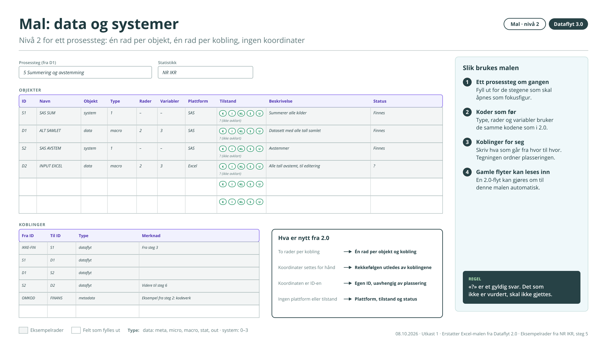

# Mal D2: Data og systemer

Nivå 2: datasettene og systemene i hvert prosessteg, og koblingene mellom dem. Malen erstatter Excel-malen fra Dataflyt 2.0. Malen bygger på [figur D2](../5-slik-kartlegger-du.md#figur-d2).

!!! info "Slik fyller du ut"

    1. **Ta ett prosessteg om gangen,** og skriv stegnummeret fra D1 i første kolonne.
    2. **Velg type, rader og variabler** med de samme kodene som i Dataflyt 2.0.
    3. **Skriv koblingene** med ID-ene fra objekttabellen.
    4. **Stabil tilstand** er der datasettet lagres i en vedtatt Dapla-tilstand. Velg «?» hvis du ikke vet.

    Svarene lagres bare i denne nettleseren. Når du er ferdig, trykker du **Lag tekst til skillen** og kopierer teksten inn i Claude. Du kan også laste ned svarene eller ta en sikkerhetskopi fra [oversikten](index.md#svarene-dine).

<button type="button" class="md-button md-button--primary" data-gjor="skill">Lag tekst til skillen</button><button type="button" class="md-button" data-gjor="kopier">Kopier svarene</button><button type="button" class="md-button" data-gjor="lastned">Last ned (.md)</button><button type="button" class="md-button" data-gjor="skrivut">Skriv ut</button><button type="button" class="md-button ark-tom" data-gjor="tom">Tøm malen</button>

Tekst til skillen ssb-dataflyt. Kopier den inn i en samtale med Claude, gjerne sammen med en eventuell 2.0-fil i Excel.
<textarea readonly rows="8" aria-label="Tekst til skillen"></textarea><button type="button" class="md-button" data-gjor="kopierskill">Kopier teksten</button>
<form class="ark-skjema" onsubmit="return false"><datalist id="plattformer"><option value="FAME"><option value="SAS"><option value="Oracle ODI"><option value="Oracle Forms"><option value="ISEE"><option value="Dynarev"><option value="KOSTRA-innrapportering"><option value="Statistikkbanken"><option value="Excel"><option value="R"><option value="Python"><option value="Dapla"></datalist><datalist id="roller"><option value="saksbehandler"><option value="statistikkansvarlig"><option value="metode"><option value="IT/utvikler"><option value="formidling"><option value="ekstern leverandør"></datalist><section class="ark-del ark-felles-del"><h3>Om statistikken (følger med på alle malene)</h3>
<label class="ark-felt">Statistikk<input type="text" data-k="felles.statistikk" data-l="Statistikk" placeholder="Eksempel: Inntekts- og kapitalregnskapet" class=""></label><label class="ark-felt">Kortnavn<input type="text" data-k="felles.kortnavn" data-l="Kortnavn" placeholder="Eksempel: NR IKR" class=""></label><label class="ark-felt">Seksjon<input type="text" data-k="felles.seksjon" data-l="Seksjon" placeholder="Eksempel: Seksjon for nasjonalregnskap" class=""></label><label class="ark-felt">Kontaktperson<input type="text" data-k="felles.kontakt" data-l="Kontaktperson" placeholder="Rolle eller navn" class=""></label>

<label class="ark-felt">Gjelder malen én statistikk eller en gruppe?<select data-k="felles.gjelder" data-l="Gjelder" class=""><option value=""></option><option value="en">Én statistikk</option><option value="gruppe">En gruppe statistikker</option></select></label><label class="ark-felt">Statistikker i gruppen<input type="text" data-k="felles.gruppe" data-l="Statistikker i gruppen" placeholder="Bare for grupper: kortnavn eller initialer" class=""></label><label class="ark-felt">Dato<input type="text" data-k="felles.dato" data-l="Dato" placeholder="Eksempel: 19.11.2026" class=""></label>
</section><section class="ark-del "><h3>Prosesstegene</h3>
Prosesstegene fra mal D1
–

</section><section class="ark-del "><h3>Objekter: data og systemer</h3>
Én rad per datasett eller system. ID-en er fri, men må være unik (for eksempel S1, S2 for systemer og D1, D2 for data). Samme system kan stå flere ganger hvis det brukes flere steder.

<table class="ark-t"><thead><tr><th>#</th><th>Steg</th><th>ID</th><th>Navn</th><th>Objekt</th><th>Type</th><th>Rader</th><th>Variabler</th><th>Plattform</th><th>Stabil tilstand</th><th>Beskrivelse</th><th>Status</th></tr></thead><tbody><tr><td class="ark-nr">1</td><td style="min-width:4em"><input type="text" data-k="D2.obj.1.steg" data-l="Steg" placeholder="5" class=""></td><td style="min-width:5em"><input type="text" data-k="D2.obj.1.id" data-l="ID" placeholder="S1" class=""></td><td style="min-width:10em"><input type="text" data-k="D2.obj.1.navn" data-l="Navn" placeholder="SAS SUM" class=""></td><td style="min-width:6em"><select data-k="D2.obj.1.objekt" data-l="Objekt" class=""><option value=""></option><option value="data">data</option><option value="system">system</option></select></td><td style="min-width:11em"><select data-k="D2.obj.1.type" data-l="Type" class=""><option value=""></option><option value="meta">meta · metadata</option><option value="micro">micro · mikrodata</option><option value="macro">macro · makrodata</option><option value="stat">stat · statistikk</option><option value="out">out · utdata</option><option value="qual">qual · kvalitetsindikator</option><option value="sys0">system 0 · neste nivå</option><option value="sys1">system 1 · skreddersydd kode</option><option value="sys2">system 2 · rammeverk med meny</option><option value="sys3">system 3 · rammeverk</option><option value="?">?</option></select></td><td style="min-width:7em"><select data-k="D2.obj.1.rader" data-l="Rader" class=""><option value=""></option><option value="1">1 · lite</option><option value="2">2 · middels</option><option value="3">3 · mye</option><option value="?">?</option></select></td><td style="min-width:8em"><select data-k="D2.obj.1.variabler" data-l="Variabler" class=""><option value=""></option><option value="1">1 · svært få</option><option value="2">2 · få</option><option value="3">3 · mange</option><option value="4">4 · svært mange</option><option value="?">?</option></select></td><td style="min-width:8em"><input type="text" data-k="D2.obj.1.plattform" data-l="Plattform" placeholder="SAS" list="plattformer" class=""></td><td style="min-width:9em"><select data-k="D2.obj.1.tilstand" data-l="Stabil tilstand" class=""><option value=""></option><option value="K">K · kildedata</option><option value="I">I · inndata</option><option value="KL">KL · klargjorte data</option><option value="S">S · statistikk</option><option value="U">U · utdata</option><option value="ingen">ingen</option><option value="?">?</option></select></td><td style="min-width:14em"><textarea data-k="D2.obj.1.beskr" data-l="Beskrivelse" rows="1" placeholder="Summerer alle kilder"></textarea></td><td style="min-width:7em"><select data-k="D2.obj.1.status" data-l="Status" class=""><option value=""></option><option value="finnes">finnes</option><option value="under arbeid">under arbeid</option><option value="forslag">forslag</option><option value="?">?</option></select></td></tr><tr><td class="ark-nr">2</td><td style="min-width:4em"><input type="text" data-k="D2.obj.2.steg" data-l="Steg" class=""></td><td style="min-width:5em"><input type="text" data-k="D2.obj.2.id" data-l="ID" class=""></td><td style="min-width:10em"><input type="text" data-k="D2.obj.2.navn" data-l="Navn" class=""></td><td style="min-width:6em"><select data-k="D2.obj.2.objekt" data-l="Objekt" class=""><option value=""></option><option value="data">data</option><option value="system">system</option></select></td><td style="min-width:11em"><select data-k="D2.obj.2.type" data-l="Type" class=""><option value=""></option><option value="meta">meta · metadata</option><option value="micro">micro · mikrodata</option><option value="macro">macro · makrodata</option><option value="stat">stat · statistikk</option><option value="out">out · utdata</option><option value="qual">qual · kvalitetsindikator</option><option value="sys0">system 0 · neste nivå</option><option value="sys1">system 1 · skreddersydd kode</option><option value="sys2">system 2 · rammeverk med meny</option><option value="sys3">system 3 · rammeverk</option><option value="?">?</option></select></td><td style="min-width:7em"><select data-k="D2.obj.2.rader" data-l="Rader" class=""><option value=""></option><option value="1">1 · lite</option><option value="2">2 · middels</option><option value="3">3 · mye</option><option value="?">?</option></select></td><td style="min-width:8em"><select data-k="D2.obj.2.variabler" data-l="Variabler" class=""><option value=""></option><option value="1">1 · svært få</option><option value="2">2 · få</option><option value="3">3 · mange</option><option value="4">4 · svært mange</option><option value="?">?</option></select></td><td style="min-width:8em"><input type="text" data-k="D2.obj.2.plattform" data-l="Plattform" list="plattformer" class=""></td><td style="min-width:9em"><select data-k="D2.obj.2.tilstand" data-l="Stabil tilstand" class=""><option value=""></option><option value="K">K · kildedata</option><option value="I">I · inndata</option><option value="KL">KL · klargjorte data</option><option value="S">S · statistikk</option><option value="U">U · utdata</option><option value="ingen">ingen</option><option value="?">?</option></select></td><td style="min-width:14em"><textarea data-k="D2.obj.2.beskr" data-l="Beskrivelse" rows="1"></textarea></td><td style="min-width:7em"><select data-k="D2.obj.2.status" data-l="Status" class=""><option value=""></option><option value="finnes">finnes</option><option value="under arbeid">under arbeid</option><option value="forslag">forslag</option><option value="?">?</option></select></td></tr><tr><td class="ark-nr">3</td><td style="min-width:4em"><input type="text" data-k="D2.obj.3.steg" data-l="Steg" class=""></td><td style="min-width:5em"><input type="text" data-k="D2.obj.3.id" data-l="ID" class=""></td><td style="min-width:10em"><input type="text" data-k="D2.obj.3.navn" data-l="Navn" class=""></td><td style="min-width:6em"><select data-k="D2.obj.3.objekt" data-l="Objekt" class=""><option value=""></option><option value="data">data</option><option value="system">system</option></select></td><td style="min-width:11em"><select data-k="D2.obj.3.type" data-l="Type" class=""><option value=""></option><option value="meta">meta · metadata</option><option value="micro">micro · mikrodata</option><option value="macro">macro · makrodata</option><option value="stat">stat · statistikk</option><option value="out">out · utdata</option><option value="qual">qual · kvalitetsindikator</option><option value="sys0">system 0 · neste nivå</option><option value="sys1">system 1 · skreddersydd kode</option><option value="sys2">system 2 · rammeverk med meny</option><option value="sys3">system 3 · rammeverk</option><option value="?">?</option></select></td><td style="min-width:7em"><select data-k="D2.obj.3.rader" data-l="Rader" class=""><option value=""></option><option value="1">1 · lite</option><option value="2">2 · middels</option><option value="3">3 · mye</option><option value="?">?</option></select></td><td style="min-width:8em"><select data-k="D2.obj.3.variabler" data-l="Variabler" class=""><option value=""></option><option value="1">1 · svært få</option><option value="2">2 · få</option><option value="3">3 · mange</option><option value="4">4 · svært mange</option><option value="?">?</option></select></td><td style="min-width:8em"><input type="text" data-k="D2.obj.3.plattform" data-l="Plattform" list="plattformer" class=""></td><td style="min-width:9em"><select data-k="D2.obj.3.tilstand" data-l="Stabil tilstand" class=""><option value=""></option><option value="K">K · kildedata</option><option value="I">I · inndata</option><option value="KL">KL · klargjorte data</option><option value="S">S · statistikk</option><option value="U">U · utdata</option><option value="ingen">ingen</option><option value="?">?</option></select></td><td style="min-width:14em"><textarea data-k="D2.obj.3.beskr" data-l="Beskrivelse" rows="1"></textarea></td><td style="min-width:7em"><select data-k="D2.obj.3.status" data-l="Status" class=""><option value=""></option><option value="finnes">finnes</option><option value="under arbeid">under arbeid</option><option value="forslag">forslag</option><option value="?">?</option></select></td></tr><tr><td class="ark-nr">4</td><td style="min-width:4em"><input type="text" data-k="D2.obj.4.steg" data-l="Steg" class=""></td><td style="min-width:5em"><input type="text" data-k="D2.obj.4.id" data-l="ID" class=""></td><td style="min-width:10em"><input type="text" data-k="D2.obj.4.navn" data-l="Navn" class=""></td><td style="min-width:6em"><select data-k="D2.obj.4.objekt" data-l="Objekt" class=""><option value=""></option><option value="data">data</option><option value="system">system</option></select></td><td style="min-width:11em"><select data-k="D2.obj.4.type" data-l="Type" class=""><option value=""></option><option value="meta">meta · metadata</option><option value="micro">micro · mikrodata</option><option value="macro">macro · makrodata</option><option value="stat">stat · statistikk</option><option value="out">out · utdata</option><option value="qual">qual · kvalitetsindikator</option><option value="sys0">system 0 · neste nivå</option><option value="sys1">system 1 · skreddersydd kode</option><option value="sys2">system 2 · rammeverk med meny</option><option value="sys3">system 3 · rammeverk</option><option value="?">?</option></select></td><td style="min-width:7em"><select data-k="D2.obj.4.rader" data-l="Rader" class=""><option value=""></option><option value="1">1 · lite</option><option value="2">2 · middels</option><option value="3">3 · mye</option><option value="?">?</option></select></td><td style="min-width:8em"><select data-k="D2.obj.4.variabler" data-l="Variabler" class=""><option value=""></option><option value="1">1 · svært få</option><option value="2">2 · få</option><option value="3">3 · mange</option><option value="4">4 · svært mange</option><option value="?">?</option></select></td><td style="min-width:8em"><input type="text" data-k="D2.obj.4.plattform" data-l="Plattform" list="plattformer" class=""></td><td style="min-width:9em"><select data-k="D2.obj.4.tilstand" data-l="Stabil tilstand" class=""><option value=""></option><option value="K">K · kildedata</option><option value="I">I · inndata</option><option value="KL">KL · klargjorte data</option><option value="S">S · statistikk</option><option value="U">U · utdata</option><option value="ingen">ingen</option><option value="?">?</option></select></td><td style="min-width:14em"><textarea data-k="D2.obj.4.beskr" data-l="Beskrivelse" rows="1"></textarea></td><td style="min-width:7em"><select data-k="D2.obj.4.status" data-l="Status" class=""><option value=""></option><option value="finnes">finnes</option><option value="under arbeid">under arbeid</option><option value="forslag">forslag</option><option value="?">?</option></select></td></tr><tr><td class="ark-nr">5</td><td style="min-width:4em"><input type="text" data-k="D2.obj.5.steg" data-l="Steg" class=""></td><td style="min-width:5em"><input type="text" data-k="D2.obj.5.id" data-l="ID" class=""></td><td style="min-width:10em"><input type="text" data-k="D2.obj.5.navn" data-l="Navn" class=""></td><td style="min-width:6em"><select data-k="D2.obj.5.objekt" data-l="Objekt" class=""><option value=""></option><option value="data">data</option><option value="system">system</option></select></td><td style="min-width:11em"><select data-k="D2.obj.5.type" data-l="Type" class=""><option value=""></option><option value="meta">meta · metadata</option><option value="micro">micro · mikrodata</option><option value="macro">macro · makrodata</option><option value="stat">stat · statistikk</option><option value="out">out · utdata</option><option value="qual">qual · kvalitetsindikator</option><option value="sys0">system 0 · neste nivå</option><option value="sys1">system 1 · skreddersydd kode</option><option value="sys2">system 2 · rammeverk med meny</option><option value="sys3">system 3 · rammeverk</option><option value="?">?</option></select></td><td style="min-width:7em"><select data-k="D2.obj.5.rader" data-l="Rader" class=""><option value=""></option><option value="1">1 · lite</option><option value="2">2 · middels</option><option value="3">3 · mye</option><option value="?">?</option></select></td><td style="min-width:8em"><select data-k="D2.obj.5.variabler" data-l="Variabler" class=""><option value=""></option><option value="1">1 · svært få</option><option value="2">2 · få</option><option value="3">3 · mange</option><option value="4">4 · svært mange</option><option value="?">?</option></select></td><td style="min-width:8em"><input type="text" data-k="D2.obj.5.plattform" data-l="Plattform" list="plattformer" class=""></td><td style="min-width:9em"><select data-k="D2.obj.5.tilstand" data-l="Stabil tilstand" class=""><option value=""></option><option value="K">K · kildedata</option><option value="I">I · inndata</option><option value="KL">KL · klargjorte data</option><option value="S">S · statistikk</option><option value="U">U · utdata</option><option value="ingen">ingen</option><option value="?">?</option></select></td><td style="min-width:14em"><textarea data-k="D2.obj.5.beskr" data-l="Beskrivelse" rows="1"></textarea></td><td style="min-width:7em"><select data-k="D2.obj.5.status" data-l="Status" class=""><option value=""></option><option value="finnes">finnes</option><option value="under arbeid">under arbeid</option><option value="forslag">forslag</option><option value="?">?</option></select></td></tr><tr><td class="ark-nr">6</td><td style="min-width:4em"><input type="text" data-k="D2.obj.6.steg" data-l="Steg" class=""></td><td style="min-width:5em"><input type="text" data-k="D2.obj.6.id" data-l="ID" class=""></td><td style="min-width:10em"><input type="text" data-k="D2.obj.6.navn" data-l="Navn" class=""></td><td style="min-width:6em"><select data-k="D2.obj.6.objekt" data-l="Objekt" class=""><option value=""></option><option value="data">data</option><option value="system">system</option></select></td><td style="min-width:11em"><select data-k="D2.obj.6.type" data-l="Type" class=""><option value=""></option><option value="meta">meta · metadata</option><option value="micro">micro · mikrodata</option><option value="macro">macro · makrodata</option><option value="stat">stat · statistikk</option><option value="out">out · utdata</option><option value="qual">qual · kvalitetsindikator</option><option value="sys0">system 0 · neste nivå</option><option value="sys1">system 1 · skreddersydd kode</option><option value="sys2">system 2 · rammeverk med meny</option><option value="sys3">system 3 · rammeverk</option><option value="?">?</option></select></td><td style="min-width:7em"><select data-k="D2.obj.6.rader" data-l="Rader" class=""><option value=""></option><option value="1">1 · lite</option><option value="2">2 · middels</option><option value="3">3 · mye</option><option value="?">?</option></select></td><td style="min-width:8em"><select data-k="D2.obj.6.variabler" data-l="Variabler" class=""><option value=""></option><option value="1">1 · svært få</option><option value="2">2 · få</option><option value="3">3 · mange</option><option value="4">4 · svært mange</option><option value="?">?</option></select></td><td style="min-width:8em"><input type="text" data-k="D2.obj.6.plattform" data-l="Plattform" list="plattformer" class=""></td><td style="min-width:9em"><select data-k="D2.obj.6.tilstand" data-l="Stabil tilstand" class=""><option value=""></option><option value="K">K · kildedata</option><option value="I">I · inndata</option><option value="KL">KL · klargjorte data</option><option value="S">S · statistikk</option><option value="U">U · utdata</option><option value="ingen">ingen</option><option value="?">?</option></select></td><td style="min-width:14em"><textarea data-k="D2.obj.6.beskr" data-l="Beskrivelse" rows="1"></textarea></td><td style="min-width:7em"><select data-k="D2.obj.6.status" data-l="Status" class=""><option value=""></option><option value="finnes">finnes</option><option value="under arbeid">under arbeid</option><option value="forslag">forslag</option><option value="?">?</option></select></td></tr><tr><td class="ark-nr">7</td><td style="min-width:4em"><input type="text" data-k="D2.obj.7.steg" data-l="Steg" class=""></td><td style="min-width:5em"><input type="text" data-k="D2.obj.7.id" data-l="ID" class=""></td><td style="min-width:10em"><input type="text" data-k="D2.obj.7.navn" data-l="Navn" class=""></td><td style="min-width:6em"><select data-k="D2.obj.7.objekt" data-l="Objekt" class=""><option value=""></option><option value="data">data</option><option value="system">system</option></select></td><td style="min-width:11em"><select data-k="D2.obj.7.type" data-l="Type" class=""><option value=""></option><option value="meta">meta · metadata</option><option value="micro">micro · mikrodata</option><option value="macro">macro · makrodata</option><option value="stat">stat · statistikk</option><option value="out">out · utdata</option><option value="qual">qual · kvalitetsindikator</option><option value="sys0">system 0 · neste nivå</option><option value="sys1">system 1 · skreddersydd kode</option><option value="sys2">system 2 · rammeverk med meny</option><option value="sys3">system 3 · rammeverk</option><option value="?">?</option></select></td><td style="min-width:7em"><select data-k="D2.obj.7.rader" data-l="Rader" class=""><option value=""></option><option value="1">1 · lite</option><option value="2">2 · middels</option><option value="3">3 · mye</option><option value="?">?</option></select></td><td style="min-width:8em"><select data-k="D2.obj.7.variabler" data-l="Variabler" class=""><option value=""></option><option value="1">1 · svært få</option><option value="2">2 · få</option><option value="3">3 · mange</option><option value="4">4 · svært mange</option><option value="?">?</option></select></td><td style="min-width:8em"><input type="text" data-k="D2.obj.7.plattform" data-l="Plattform" list="plattformer" class=""></td><td style="min-width:9em"><select data-k="D2.obj.7.tilstand" data-l="Stabil tilstand" class=""><option value=""></option><option value="K">K · kildedata</option><option value="I">I · inndata</option><option value="KL">KL · klargjorte data</option><option value="S">S · statistikk</option><option value="U">U · utdata</option><option value="ingen">ingen</option><option value="?">?</option></select></td><td style="min-width:14em"><textarea data-k="D2.obj.7.beskr" data-l="Beskrivelse" rows="1"></textarea></td><td style="min-width:7em"><select data-k="D2.obj.7.status" data-l="Status" class=""><option value=""></option><option value="finnes">finnes</option><option value="under arbeid">under arbeid</option><option value="forslag">forslag</option><option value="?">?</option></select></td></tr><tr><td class="ark-nr">8</td><td style="min-width:4em"><input type="text" data-k="D2.obj.8.steg" data-l="Steg" class=""></td><td style="min-width:5em"><input type="text" data-k="D2.obj.8.id" data-l="ID" class=""></td><td style="min-width:10em"><input type="text" data-k="D2.obj.8.navn" data-l="Navn" class=""></td><td style="min-width:6em"><select data-k="D2.obj.8.objekt" data-l="Objekt" class=""><option value=""></option><option value="data">data</option><option value="system">system</option></select></td><td style="min-width:11em"><select data-k="D2.obj.8.type" data-l="Type" class=""><option value=""></option><option value="meta">meta · metadata</option><option value="micro">micro · mikrodata</option><option value="macro">macro · makrodata</option><option value="stat">stat · statistikk</option><option value="out">out · utdata</option><option value="qual">qual · kvalitetsindikator</option><option value="sys0">system 0 · neste nivå</option><option value="sys1">system 1 · skreddersydd kode</option><option value="sys2">system 2 · rammeverk med meny</option><option value="sys3">system 3 · rammeverk</option><option value="?">?</option></select></td><td style="min-width:7em"><select data-k="D2.obj.8.rader" data-l="Rader" class=""><option value=""></option><option value="1">1 · lite</option><option value="2">2 · middels</option><option value="3">3 · mye</option><option value="?">?</option></select></td><td style="min-width:8em"><select data-k="D2.obj.8.variabler" data-l="Variabler" class=""><option value=""></option><option value="1">1 · svært få</option><option value="2">2 · få</option><option value="3">3 · mange</option><option value="4">4 · svært mange</option><option value="?">?</option></select></td><td style="min-width:8em"><input type="text" data-k="D2.obj.8.plattform" data-l="Plattform" list="plattformer" class=""></td><td style="min-width:9em"><select data-k="D2.obj.8.tilstand" data-l="Stabil tilstand" class=""><option value=""></option><option value="K">K · kildedata</option><option value="I">I · inndata</option><option value="KL">KL · klargjorte data</option><option value="S">S · statistikk</option><option value="U">U · utdata</option><option value="ingen">ingen</option><option value="?">?</option></select></td><td style="min-width:14em"><textarea data-k="D2.obj.8.beskr" data-l="Beskrivelse" rows="1"></textarea></td><td style="min-width:7em"><select data-k="D2.obj.8.status" data-l="Status" class=""><option value=""></option><option value="finnes">finnes</option><option value="under arbeid">under arbeid</option><option value="forslag">forslag</option><option value="?">?</option></select></td></tr><tr><td class="ark-nr">9</td><td style="min-width:4em"><input type="text" data-k="D2.obj.9.steg" data-l="Steg" class=""></td><td style="min-width:5em"><input type="text" data-k="D2.obj.9.id" data-l="ID" class=""></td><td style="min-width:10em"><input type="text" data-k="D2.obj.9.navn" data-l="Navn" class=""></td><td style="min-width:6em"><select data-k="D2.obj.9.objekt" data-l="Objekt" class=""><option value=""></option><option value="data">data</option><option value="system">system</option></select></td><td style="min-width:11em"><select data-k="D2.obj.9.type" data-l="Type" class=""><option value=""></option><option value="meta">meta · metadata</option><option value="micro">micro · mikrodata</option><option value="macro">macro · makrodata</option><option value="stat">stat · statistikk</option><option value="out">out · utdata</option><option value="qual">qual · kvalitetsindikator</option><option value="sys0">system 0 · neste nivå</option><option value="sys1">system 1 · skreddersydd kode</option><option value="sys2">system 2 · rammeverk med meny</option><option value="sys3">system 3 · rammeverk</option><option value="?">?</option></select></td><td style="min-width:7em"><select data-k="D2.obj.9.rader" data-l="Rader" class=""><option value=""></option><option value="1">1 · lite</option><option value="2">2 · middels</option><option value="3">3 · mye</option><option value="?">?</option></select></td><td style="min-width:8em"><select data-k="D2.obj.9.variabler" data-l="Variabler" class=""><option value=""></option><option value="1">1 · svært få</option><option value="2">2 · få</option><option value="3">3 · mange</option><option value="4">4 · svært mange</option><option value="?">?</option></select></td><td style="min-width:8em"><input type="text" data-k="D2.obj.9.plattform" data-l="Plattform" list="plattformer" class=""></td><td style="min-width:9em"><select data-k="D2.obj.9.tilstand" data-l="Stabil tilstand" class=""><option value=""></option><option value="K">K · kildedata</option><option value="I">I · inndata</option><option value="KL">KL · klargjorte data</option><option value="S">S · statistikk</option><option value="U">U · utdata</option><option value="ingen">ingen</option><option value="?">?</option></select></td><td style="min-width:14em"><textarea data-k="D2.obj.9.beskr" data-l="Beskrivelse" rows="1"></textarea></td><td style="min-width:7em"><select data-k="D2.obj.9.status" data-l="Status" class=""><option value=""></option><option value="finnes">finnes</option><option value="under arbeid">under arbeid</option><option value="forslag">forslag</option><option value="?">?</option></select></td></tr><tr><td class="ark-nr">10</td><td style="min-width:4em"><input type="text" data-k="D2.obj.10.steg" data-l="Steg" class=""></td><td style="min-width:5em"><input type="text" data-k="D2.obj.10.id" data-l="ID" class=""></td><td style="min-width:10em"><input type="text" data-k="D2.obj.10.navn" data-l="Navn" class=""></td><td style="min-width:6em"><select data-k="D2.obj.10.objekt" data-l="Objekt" class=""><option value=""></option><option value="data">data</option><option value="system">system</option></select></td><td style="min-width:11em"><select data-k="D2.obj.10.type" data-l="Type" class=""><option value=""></option><option value="meta">meta · metadata</option><option value="micro">micro · mikrodata</option><option value="macro">macro · makrodata</option><option value="stat">stat · statistikk</option><option value="out">out · utdata</option><option value="qual">qual · kvalitetsindikator</option><option value="sys0">system 0 · neste nivå</option><option value="sys1">system 1 · skreddersydd kode</option><option value="sys2">system 2 · rammeverk med meny</option><option value="sys3">system 3 · rammeverk</option><option value="?">?</option></select></td><td style="min-width:7em"><select data-k="D2.obj.10.rader" data-l="Rader" class=""><option value=""></option><option value="1">1 · lite</option><option value="2">2 · middels</option><option value="3">3 · mye</option><option value="?">?</option></select></td><td style="min-width:8em"><select data-k="D2.obj.10.variabler" data-l="Variabler" class=""><option value=""></option><option value="1">1 · svært få</option><option value="2">2 · få</option><option value="3">3 · mange</option><option value="4">4 · svært mange</option><option value="?">?</option></select></td><td style="min-width:8em"><input type="text" data-k="D2.obj.10.plattform" data-l="Plattform" list="plattformer" class=""></td><td style="min-width:9em"><select data-k="D2.obj.10.tilstand" data-l="Stabil tilstand" class=""><option value=""></option><option value="K">K · kildedata</option><option value="I">I · inndata</option><option value="KL">KL · klargjorte data</option><option value="S">S · statistikk</option><option value="U">U · utdata</option><option value="ingen">ingen</option><option value="?">?</option></select></td><td style="min-width:14em"><textarea data-k="D2.obj.10.beskr" data-l="Beskrivelse" rows="1"></textarea></td><td style="min-width:7em"><select data-k="D2.obj.10.status" data-l="Status" class=""><option value=""></option><option value="finnes">finnes</option><option value="under arbeid">under arbeid</option><option value="forslag">forslag</option><option value="?">?</option></select></td></tr><tr><td class="ark-nr">11</td><td style="min-width:4em"><input type="text" data-k="D2.obj.11.steg" data-l="Steg" class=""></td><td style="min-width:5em"><input type="text" data-k="D2.obj.11.id" data-l="ID" class=""></td><td style="min-width:10em"><input type="text" data-k="D2.obj.11.navn" data-l="Navn" class=""></td><td style="min-width:6em"><select data-k="D2.obj.11.objekt" data-l="Objekt" class=""><option value=""></option><option value="data">data</option><option value="system">system</option></select></td><td style="min-width:11em"><select data-k="D2.obj.11.type" data-l="Type" class=""><option value=""></option><option value="meta">meta · metadata</option><option value="micro">micro · mikrodata</option><option value="macro">macro · makrodata</option><option value="stat">stat · statistikk</option><option value="out">out · utdata</option><option value="qual">qual · kvalitetsindikator</option><option value="sys0">system 0 · neste nivå</option><option value="sys1">system 1 · skreddersydd kode</option><option value="sys2">system 2 · rammeverk med meny</option><option value="sys3">system 3 · rammeverk</option><option value="?">?</option></select></td><td style="min-width:7em"><select data-k="D2.obj.11.rader" data-l="Rader" class=""><option value=""></option><option value="1">1 · lite</option><option value="2">2 · middels</option><option value="3">3 · mye</option><option value="?">?</option></select></td><td style="min-width:8em"><select data-k="D2.obj.11.variabler" data-l="Variabler" class=""><option value=""></option><option value="1">1 · svært få</option><option value="2">2 · få</option><option value="3">3 · mange</option><option value="4">4 · svært mange</option><option value="?">?</option></select></td><td style="min-width:8em"><input type="text" data-k="D2.obj.11.plattform" data-l="Plattform" list="plattformer" class=""></td><td style="min-width:9em"><select data-k="D2.obj.11.tilstand" data-l="Stabil tilstand" class=""><option value=""></option><option value="K">K · kildedata</option><option value="I">I · inndata</option><option value="KL">KL · klargjorte data</option><option value="S">S · statistikk</option><option value="U">U · utdata</option><option value="ingen">ingen</option><option value="?">?</option></select></td><td style="min-width:14em"><textarea data-k="D2.obj.11.beskr" data-l="Beskrivelse" rows="1"></textarea></td><td style="min-width:7em"><select data-k="D2.obj.11.status" data-l="Status" class=""><option value=""></option><option value="finnes">finnes</option><option value="under arbeid">under arbeid</option><option value="forslag">forslag</option><option value="?">?</option></select></td></tr><tr><td class="ark-nr">12</td><td style="min-width:4em"><input type="text" data-k="D2.obj.12.steg" data-l="Steg" class=""></td><td style="min-width:5em"><input type="text" data-k="D2.obj.12.id" data-l="ID" class=""></td><td style="min-width:10em"><input type="text" data-k="D2.obj.12.navn" data-l="Navn" class=""></td><td style="min-width:6em"><select data-k="D2.obj.12.objekt" data-l="Objekt" class=""><option value=""></option><option value="data">data</option><option value="system">system</option></select></td><td style="min-width:11em"><select data-k="D2.obj.12.type" data-l="Type" class=""><option value=""></option><option value="meta">meta · metadata</option><option value="micro">micro · mikrodata</option><option value="macro">macro · makrodata</option><option value="stat">stat · statistikk</option><option value="out">out · utdata</option><option value="qual">qual · kvalitetsindikator</option><option value="sys0">system 0 · neste nivå</option><option value="sys1">system 1 · skreddersydd kode</option><option value="sys2">system 2 · rammeverk med meny</option><option value="sys3">system 3 · rammeverk</option><option value="?">?</option></select></td><td style="min-width:7em"><select data-k="D2.obj.12.rader" data-l="Rader" class=""><option value=""></option><option value="1">1 · lite</option><option value="2">2 · middels</option><option value="3">3 · mye</option><option value="?">?</option></select></td><td style="min-width:8em"><select data-k="D2.obj.12.variabler" data-l="Variabler" class=""><option value=""></option><option value="1">1 · svært få</option><option value="2">2 · få</option><option value="3">3 · mange</option><option value="4">4 · svært mange</option><option value="?">?</option></select></td><td style="min-width:8em"><input type="text" data-k="D2.obj.12.plattform" data-l="Plattform" list="plattformer" class=""></td><td style="min-width:9em"><select data-k="D2.obj.12.tilstand" data-l="Stabil tilstand" class=""><option value=""></option><option value="K">K · kildedata</option><option value="I">I · inndata</option><option value="KL">KL · klargjorte data</option><option value="S">S · statistikk</option><option value="U">U · utdata</option><option value="ingen">ingen</option><option value="?">?</option></select></td><td style="min-width:14em"><textarea data-k="D2.obj.12.beskr" data-l="Beskrivelse" rows="1"></textarea></td><td style="min-width:7em"><select data-k="D2.obj.12.status" data-l="Status" class=""><option value=""></option><option value="finnes">finnes</option><option value="under arbeid">under arbeid</option><option value="forslag">forslag</option><option value="?">?</option></select></td></tr><tr><td class="ark-nr">13</td><td style="min-width:4em"><input type="text" data-k="D2.obj.13.steg" data-l="Steg" class=""></td><td style="min-width:5em"><input type="text" data-k="D2.obj.13.id" data-l="ID" class=""></td><td style="min-width:10em"><input type="text" data-k="D2.obj.13.navn" data-l="Navn" class=""></td><td style="min-width:6em"><select data-k="D2.obj.13.objekt" data-l="Objekt" class=""><option value=""></option><option value="data">data</option><option value="system">system</option></select></td><td style="min-width:11em"><select data-k="D2.obj.13.type" data-l="Type" class=""><option value=""></option><option value="meta">meta · metadata</option><option value="micro">micro · mikrodata</option><option value="macro">macro · makrodata</option><option value="stat">stat · statistikk</option><option value="out">out · utdata</option><option value="qual">qual · kvalitetsindikator</option><option value="sys0">system 0 · neste nivå</option><option value="sys1">system 1 · skreddersydd kode</option><option value="sys2">system 2 · rammeverk med meny</option><option value="sys3">system 3 · rammeverk</option><option value="?">?</option></select></td><td style="min-width:7em"><select data-k="D2.obj.13.rader" data-l="Rader" class=""><option value=""></option><option value="1">1 · lite</option><option value="2">2 · middels</option><option value="3">3 · mye</option><option value="?">?</option></select></td><td style="min-width:8em"><select data-k="D2.obj.13.variabler" data-l="Variabler" class=""><option value=""></option><option value="1">1 · svært få</option><option value="2">2 · få</option><option value="3">3 · mange</option><option value="4">4 · svært mange</option><option value="?">?</option></select></td><td style="min-width:8em"><input type="text" data-k="D2.obj.13.plattform" data-l="Plattform" list="plattformer" class=""></td><td style="min-width:9em"><select data-k="D2.obj.13.tilstand" data-l="Stabil tilstand" class=""><option value=""></option><option value="K">K · kildedata</option><option value="I">I · inndata</option><option value="KL">KL · klargjorte data</option><option value="S">S · statistikk</option><option value="U">U · utdata</option><option value="ingen">ingen</option><option value="?">?</option></select></td><td style="min-width:14em"><textarea data-k="D2.obj.13.beskr" data-l="Beskrivelse" rows="1"></textarea></td><td style="min-width:7em"><select data-k="D2.obj.13.status" data-l="Status" class=""><option value=""></option><option value="finnes">finnes</option><option value="under arbeid">under arbeid</option><option value="forslag">forslag</option><option value="?">?</option></select></td></tr><tr><td class="ark-nr">14</td><td style="min-width:4em"><input type="text" data-k="D2.obj.14.steg" data-l="Steg" class=""></td><td style="min-width:5em"><input type="text" data-k="D2.obj.14.id" data-l="ID" class=""></td><td style="min-width:10em"><input type="text" data-k="D2.obj.14.navn" data-l="Navn" class=""></td><td style="min-width:6em"><select data-k="D2.obj.14.objekt" data-l="Objekt" class=""><option value=""></option><option value="data">data</option><option value="system">system</option></select></td><td style="min-width:11em"><select data-k="D2.obj.14.type" data-l="Type" class=""><option value=""></option><option value="meta">meta · metadata</option><option value="micro">micro · mikrodata</option><option value="macro">macro · makrodata</option><option value="stat">stat · statistikk</option><option value="out">out · utdata</option><option value="qual">qual · kvalitetsindikator</option><option value="sys0">system 0 · neste nivå</option><option value="sys1">system 1 · skreddersydd kode</option><option value="sys2">system 2 · rammeverk med meny</option><option value="sys3">system 3 · rammeverk</option><option value="?">?</option></select></td><td style="min-width:7em"><select data-k="D2.obj.14.rader" data-l="Rader" class=""><option value=""></option><option value="1">1 · lite</option><option value="2">2 · middels</option><option value="3">3 · mye</option><option value="?">?</option></select></td><td style="min-width:8em"><select data-k="D2.obj.14.variabler" data-l="Variabler" class=""><option value=""></option><option value="1">1 · svært få</option><option value="2">2 · få</option><option value="3">3 · mange</option><option value="4">4 · svært mange</option><option value="?">?</option></select></td><td style="min-width:8em"><input type="text" data-k="D2.obj.14.plattform" data-l="Plattform" list="plattformer" class=""></td><td style="min-width:9em"><select data-k="D2.obj.14.tilstand" data-l="Stabil tilstand" class=""><option value=""></option><option value="K">K · kildedata</option><option value="I">I · inndata</option><option value="KL">KL · klargjorte data</option><option value="S">S · statistikk</option><option value="U">U · utdata</option><option value="ingen">ingen</option><option value="?">?</option></select></td><td style="min-width:14em"><textarea data-k="D2.obj.14.beskr" data-l="Beskrivelse" rows="1"></textarea></td><td style="min-width:7em"><select data-k="D2.obj.14.status" data-l="Status" class=""><option value=""></option><option value="finnes">finnes</option><option value="under arbeid">under arbeid</option><option value="forslag">forslag</option><option value="?">?</option></select></td></tr><tr><td class="ark-nr">15</td><td style="min-width:4em"><input type="text" data-k="D2.obj.15.steg" data-l="Steg" class=""></td><td style="min-width:5em"><input type="text" data-k="D2.obj.15.id" data-l="ID" class=""></td><td style="min-width:10em"><input type="text" data-k="D2.obj.15.navn" data-l="Navn" class=""></td><td style="min-width:6em"><select data-k="D2.obj.15.objekt" data-l="Objekt" class=""><option value=""></option><option value="data">data</option><option value="system">system</option></select></td><td style="min-width:11em"><select data-k="D2.obj.15.type" data-l="Type" class=""><option value=""></option><option value="meta">meta · metadata</option><option value="micro">micro · mikrodata</option><option value="macro">macro · makrodata</option><option value="stat">stat · statistikk</option><option value="out">out · utdata</option><option value="qual">qual · kvalitetsindikator</option><option value="sys0">system 0 · neste nivå</option><option value="sys1">system 1 · skreddersydd kode</option><option value="sys2">system 2 · rammeverk med meny</option><option value="sys3">system 3 · rammeverk</option><option value="?">?</option></select></td><td style="min-width:7em"><select data-k="D2.obj.15.rader" data-l="Rader" class=""><option value=""></option><option value="1">1 · lite</option><option value="2">2 · middels</option><option value="3">3 · mye</option><option value="?">?</option></select></td><td style="min-width:8em"><select data-k="D2.obj.15.variabler" data-l="Variabler" class=""><option value=""></option><option value="1">1 · svært få</option><option value="2">2 · få</option><option value="3">3 · mange</option><option value="4">4 · svært mange</option><option value="?">?</option></select></td><td style="min-width:8em"><input type="text" data-k="D2.obj.15.plattform" data-l="Plattform" list="plattformer" class=""></td><td style="min-width:9em"><select data-k="D2.obj.15.tilstand" data-l="Stabil tilstand" class=""><option value=""></option><option value="K">K · kildedata</option><option value="I">I · inndata</option><option value="KL">KL · klargjorte data</option><option value="S">S · statistikk</option><option value="U">U · utdata</option><option value="ingen">ingen</option><option value="?">?</option></select></td><td style="min-width:14em"><textarea data-k="D2.obj.15.beskr" data-l="Beskrivelse" rows="1"></textarea></td><td style="min-width:7em"><select data-k="D2.obj.15.status" data-l="Status" class=""><option value=""></option><option value="finnes">finnes</option><option value="under arbeid">under arbeid</option><option value="forslag">forslag</option><option value="?">?</option></select></td></tr><tr><td class="ark-nr">16</td><td style="min-width:4em"><input type="text" data-k="D2.obj.16.steg" data-l="Steg" class=""></td><td style="min-width:5em"><input type="text" data-k="D2.obj.16.id" data-l="ID" class=""></td><td style="min-width:10em"><input type="text" data-k="D2.obj.16.navn" data-l="Navn" class=""></td><td style="min-width:6em"><select data-k="D2.obj.16.objekt" data-l="Objekt" class=""><option value=""></option><option value="data">data</option><option value="system">system</option></select></td><td style="min-width:11em"><select data-k="D2.obj.16.type" data-l="Type" class=""><option value=""></option><option value="meta">meta · metadata</option><option value="micro">micro · mikrodata</option><option value="macro">macro · makrodata</option><option value="stat">stat · statistikk</option><option value="out">out · utdata</option><option value="qual">qual · kvalitetsindikator</option><option value="sys0">system 0 · neste nivå</option><option value="sys1">system 1 · skreddersydd kode</option><option value="sys2">system 2 · rammeverk med meny</option><option value="sys3">system 3 · rammeverk</option><option value="?">?</option></select></td><td style="min-width:7em"><select data-k="D2.obj.16.rader" data-l="Rader" class=""><option value=""></option><option value="1">1 · lite</option><option value="2">2 · middels</option><option value="3">3 · mye</option><option value="?">?</option></select></td><td style="min-width:8em"><select data-k="D2.obj.16.variabler" data-l="Variabler" class=""><option value=""></option><option value="1">1 · svært få</option><option value="2">2 · få</option><option value="3">3 · mange</option><option value="4">4 · svært mange</option><option value="?">?</option></select></td><td style="min-width:8em"><input type="text" data-k="D2.obj.16.plattform" data-l="Plattform" list="plattformer" class=""></td><td style="min-width:9em"><select data-k="D2.obj.16.tilstand" data-l="Stabil tilstand" class=""><option value=""></option><option value="K">K · kildedata</option><option value="I">I · inndata</option><option value="KL">KL · klargjorte data</option><option value="S">S · statistikk</option><option value="U">U · utdata</option><option value="ingen">ingen</option><option value="?">?</option></select></td><td style="min-width:14em"><textarea data-k="D2.obj.16.beskr" data-l="Beskrivelse" rows="1"></textarea></td><td style="min-width:7em"><select data-k="D2.obj.16.status" data-l="Status" class=""><option value=""></option><option value="finnes">finnes</option><option value="under arbeid">under arbeid</option><option value="forslag">forslag</option><option value="?">?</option></select></td></tr></tbody></table>
</section><section class="ark-del "><h3>Koblinger</h3>
Hva går fra hvor til hvor? Bruk ID-ene over. Ingen koordinater: tegningen ordner plasseringen.

<table class="ark-t"><thead><tr><th>#</th><th>Fra ID</th><th>Til ID</th><th>Type</th><th>Merknad</th></tr></thead><tbody><tr><td class="ark-nr">1</td><td style="min-width:6em"><input type="text" data-k="D2.kob.1.fra" data-l="Fra ID" placeholder="S1" class=""></td><td style="min-width:6em"><input type="text" data-k="D2.kob.1.til" data-l="Til ID" placeholder="D1" class=""></td><td style="min-width:8em"><select data-k="D2.kob.1.type" data-l="Type" class=""><option value=""></option><option value="dataflyt">dataflyt</option><option value="metadata">metadata</option><option value="avhengighet">avhengighet</option></select></td><td style="min-width:18em"><input type="text" data-k="D2.kob.1.merknad" data-l="Merknad" placeholder="Eksempel: summen går videre til avstemming" class=""></td></tr><tr><td class="ark-nr">2</td><td style="min-width:6em"><input type="text" data-k="D2.kob.2.fra" data-l="Fra ID" class=""></td><td style="min-width:6em"><input type="text" data-k="D2.kob.2.til" data-l="Til ID" class=""></td><td style="min-width:8em"><select data-k="D2.kob.2.type" data-l="Type" class=""><option value=""></option><option value="dataflyt">dataflyt</option><option value="metadata">metadata</option><option value="avhengighet">avhengighet</option></select></td><td style="min-width:18em"><input type="text" data-k="D2.kob.2.merknad" data-l="Merknad" class=""></td></tr><tr><td class="ark-nr">3</td><td style="min-width:6em"><input type="text" data-k="D2.kob.3.fra" data-l="Fra ID" class=""></td><td style="min-width:6em"><input type="text" data-k="D2.kob.3.til" data-l="Til ID" class=""></td><td style="min-width:8em"><select data-k="D2.kob.3.type" data-l="Type" class=""><option value=""></option><option value="dataflyt">dataflyt</option><option value="metadata">metadata</option><option value="avhengighet">avhengighet</option></select></td><td style="min-width:18em"><input type="text" data-k="D2.kob.3.merknad" data-l="Merknad" class=""></td></tr><tr><td class="ark-nr">4</td><td style="min-width:6em"><input type="text" data-k="D2.kob.4.fra" data-l="Fra ID" class=""></td><td style="min-width:6em"><input type="text" data-k="D2.kob.4.til" data-l="Til ID" class=""></td><td style="min-width:8em"><select data-k="D2.kob.4.type" data-l="Type" class=""><option value=""></option><option value="dataflyt">dataflyt</option><option value="metadata">metadata</option><option value="avhengighet">avhengighet</option></select></td><td style="min-width:18em"><input type="text" data-k="D2.kob.4.merknad" data-l="Merknad" class=""></td></tr><tr><td class="ark-nr">5</td><td style="min-width:6em"><input type="text" data-k="D2.kob.5.fra" data-l="Fra ID" class=""></td><td style="min-width:6em"><input type="text" data-k="D2.kob.5.til" data-l="Til ID" class=""></td><td style="min-width:8em"><select data-k="D2.kob.5.type" data-l="Type" class=""><option value=""></option><option value="dataflyt">dataflyt</option><option value="metadata">metadata</option><option value="avhengighet">avhengighet</option></select></td><td style="min-width:18em"><input type="text" data-k="D2.kob.5.merknad" data-l="Merknad" class=""></td></tr><tr><td class="ark-nr">6</td><td style="min-width:6em"><input type="text" data-k="D2.kob.6.fra" data-l="Fra ID" class=""></td><td style="min-width:6em"><input type="text" data-k="D2.kob.6.til" data-l="Til ID" class=""></td><td style="min-width:8em"><select data-k="D2.kob.6.type" data-l="Type" class=""><option value=""></option><option value="dataflyt">dataflyt</option><option value="metadata">metadata</option><option value="avhengighet">avhengighet</option></select></td><td style="min-width:18em"><input type="text" data-k="D2.kob.6.merknad" data-l="Merknad" class=""></td></tr><tr><td class="ark-nr">7</td><td style="min-width:6em"><input type="text" data-k="D2.kob.7.fra" data-l="Fra ID" class=""></td><td style="min-width:6em"><input type="text" data-k="D2.kob.7.til" data-l="Til ID" class=""></td><td style="min-width:8em"><select data-k="D2.kob.7.type" data-l="Type" class=""><option value=""></option><option value="dataflyt">dataflyt</option><option value="metadata">metadata</option><option value="avhengighet">avhengighet</option></select></td><td style="min-width:18em"><input type="text" data-k="D2.kob.7.merknad" data-l="Merknad" class=""></td></tr><tr><td class="ark-nr">8</td><td style="min-width:6em"><input type="text" data-k="D2.kob.8.fra" data-l="Fra ID" class=""></td><td style="min-width:6em"><input type="text" data-k="D2.kob.8.til" data-l="Til ID" class=""></td><td style="min-width:8em"><select data-k="D2.kob.8.type" data-l="Type" class=""><option value=""></option><option value="dataflyt">dataflyt</option><option value="metadata">metadata</option><option value="avhengighet">avhengighet</option></select></td><td style="min-width:18em"><input type="text" data-k="D2.kob.8.merknad" data-l="Merknad" class=""></td></tr><tr><td class="ark-nr">9</td><td style="min-width:6em"><input type="text" data-k="D2.kob.9.fra" data-l="Fra ID" class=""></td><td style="min-width:6em"><input type="text" data-k="D2.kob.9.til" data-l="Til ID" class=""></td><td style="min-width:8em"><select data-k="D2.kob.9.type" data-l="Type" class=""><option value=""></option><option value="dataflyt">dataflyt</option><option value="metadata">metadata</option><option value="avhengighet">avhengighet</option></select></td><td style="min-width:18em"><input type="text" data-k="D2.kob.9.merknad" data-l="Merknad" class=""></td></tr><tr><td class="ark-nr">10</td><td style="min-width:6em"><input type="text" data-k="D2.kob.10.fra" data-l="Fra ID" class=""></td><td style="min-width:6em"><input type="text" data-k="D2.kob.10.til" data-l="Til ID" class=""></td><td style="min-width:8em"><select data-k="D2.kob.10.type" data-l="Type" class=""><option value=""></option><option value="dataflyt">dataflyt</option><option value="metadata">metadata</option><option value="avhengighet">avhengighet</option></select></td><td style="min-width:18em"><input type="text" data-k="D2.kob.10.merknad" data-l="Merknad" class=""></td></tr><tr><td class="ark-nr">11</td><td style="min-width:6em"><input type="text" data-k="D2.kob.11.fra" data-l="Fra ID" class=""></td><td style="min-width:6em"><input type="text" data-k="D2.kob.11.til" data-l="Til ID" class=""></td><td style="min-width:8em"><select data-k="D2.kob.11.type" data-l="Type" class=""><option value=""></option><option value="dataflyt">dataflyt</option><option value="metadata">metadata</option><option value="avhengighet">avhengighet</option></select></td><td style="min-width:18em"><input type="text" data-k="D2.kob.11.merknad" data-l="Merknad" class=""></td></tr><tr><td class="ark-nr">12</td><td style="min-width:6em"><input type="text" data-k="D2.kob.12.fra" data-l="Fra ID" class=""></td><td style="min-width:6em"><input type="text" data-k="D2.kob.12.til" data-l="Til ID" class=""></td><td style="min-width:8em"><select data-k="D2.kob.12.type" data-l="Type" class=""><option value=""></option><option value="dataflyt">dataflyt</option><option value="metadata">metadata</option><option value="avhengighet">avhengighet</option></select></td><td style="min-width:18em"><input type="text" data-k="D2.kob.12.merknad" data-l="Merknad" class=""></td></tr><tr><td class="ark-nr">13</td><td style="min-width:6em"><input type="text" data-k="D2.kob.13.fra" data-l="Fra ID" class=""></td><td style="min-width:6em"><input type="text" data-k="D2.kob.13.til" data-l="Til ID" class=""></td><td style="min-width:8em"><select data-k="D2.kob.13.type" data-l="Type" class=""><option value=""></option><option value="dataflyt">dataflyt</option><option value="metadata">metadata</option><option value="avhengighet">avhengighet</option></select></td><td style="min-width:18em"><input type="text" data-k="D2.kob.13.merknad" data-l="Merknad" class=""></td></tr><tr><td class="ark-nr">14</td><td style="min-width:6em"><input type="text" data-k="D2.kob.14.fra" data-l="Fra ID" class=""></td><td style="min-width:6em"><input type="text" data-k="D2.kob.14.til" data-l="Til ID" class=""></td><td style="min-width:8em"><select data-k="D2.kob.14.type" data-l="Type" class=""><option value=""></option><option value="dataflyt">dataflyt</option><option value="metadata">metadata</option><option value="avhengighet">avhengighet</option></select></td><td style="min-width:18em"><input type="text" data-k="D2.kob.14.merknad" data-l="Merknad" class=""></td></tr><tr><td class="ark-nr">15</td><td style="min-width:6em"><input type="text" data-k="D2.kob.15.fra" data-l="Fra ID" class=""></td><td style="min-width:6em"><input type="text" data-k="D2.kob.15.til" data-l="Til ID" class=""></td><td style="min-width:8em"><select data-k="D2.kob.15.type" data-l="Type" class=""><option value=""></option><option value="dataflyt">dataflyt</option><option value="metadata">metadata</option><option value="avhengighet">avhengighet</option></select></td><td style="min-width:18em"><input type="text" data-k="D2.kob.15.merknad" data-l="Merknad" class=""></td></tr><tr><td class="ark-nr">16</td><td style="min-width:6em"><input type="text" data-k="D2.kob.16.fra" data-l="Fra ID" class=""></td><td style="min-width:6em"><input type="text" data-k="D2.kob.16.til" data-l="Til ID" class=""></td><td style="min-width:8em"><select data-k="D2.kob.16.type" data-l="Type" class=""><option value=""></option><option value="dataflyt">dataflyt</option><option value="metadata">metadata</option><option value="avhengighet">avhengighet</option></select></td><td style="min-width:18em"><input type="text" data-k="D2.kob.16.merknad" data-l="Merknad" class=""></td></tr></tbody></table>
</section><section class="ark-del "><h3>Fra Dataflyt 2.0</h3><label class="ark-felt">Finnes det en tegning fra Dataflyt 2.0? Last den gjerne opp sammen med teksten.<input type="text" data-k="D2.fil20" data-l="Eksisterende 2.0-tegning" placeholder="Filnavn eller lenke, hvis det finnes" class=""></label></section></form>

??? note "Malen som figur (til utskrift eller tavle)"

    { loading=lazy }

    [Last ned SVG](../figurer/D2.svg){ download }

[← Mal D1](d1.md) · [Alle malene](index.md) · [Mal D3 →](d3.md)
