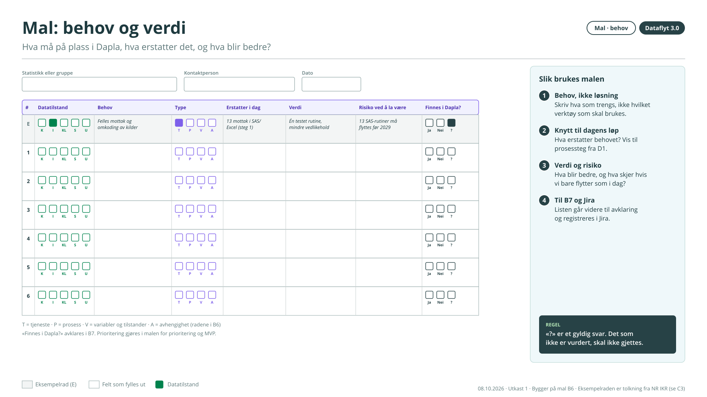

# Mal D3: Behov og verdi

Målbildet: hva som må på plass i Dapla, hva det erstatter, og hva som blir bedre. Malen bygger på [figur D3](../5-slik-kartlegger-du.md#figur-d3).

!!! info "Slik fyller du ut"

    1. **Velg datatilstand** for hvert behov: kildedata, inndata, klargjorte data, statistikk eller utdata.
    2. **Skriv behovet,** ikke løsningen.
    3. **Knytt til dagens løp:** hva erstatter behovet?
    4. **Verdi og risiko:** hva blir bedre, og hva skjer hvis vi bare flytter som i dag?

    Svarene lagres bare i denne nettleseren. Når du er ferdig, trykker du **Lag tekst til skillen** og kopierer teksten inn i Claude. Du kan også laste ned svarene eller ta en sikkerhetskopi fra [oversikten](index.md#svarene-dine).

<button type="button" class="md-button md-button--primary" data-gjor="skill">Lag tekst til skillen</button><button type="button" class="md-button" data-gjor="kopier">Kopier svarene</button><button type="button" class="md-button" data-gjor="lastned">Last ned (.md)</button><button type="button" class="md-button" data-gjor="skrivut">Skriv ut</button><button type="button" class="md-button ark-tom" data-gjor="tom">Tøm malen</button>

Tekst til skillen ssb-dataflyt. Kopier den inn i en samtale med Claude, gjerne sammen med en eventuell 2.0-fil i Excel.
<textarea readonly rows="8" aria-label="Tekst til skillen"></textarea><button type="button" class="md-button" data-gjor="kopierskill">Kopier teksten</button>
<form class="ark-skjema" onsubmit="return false"><datalist id="plattformer"><option value="FAME"><option value="SAS"><option value="Oracle ODI"><option value="Oracle Forms"><option value="ISEE"><option value="Dynarev"><option value="KOSTRA-innrapportering"><option value="Statistikkbanken"><option value="Excel"><option value="R"><option value="Python"><option value="Dapla"></datalist><datalist id="roller"><option value="saksbehandler"><option value="statistikkansvarlig"><option value="metode"><option value="IT/utvikler"><option value="formidling"><option value="ekstern leverandør"></datalist><section class="ark-del ark-felles-del"><h3>Om statistikken (følger med på alle malene)</h3>
<label class="ark-felt">Statistikk<input type="text" data-k="felles.statistikk" data-l="Statistikk" placeholder="Eksempel: Inntekts- og kapitalregnskapet" class=""></label><label class="ark-felt">Kortnavn<input type="text" data-k="felles.kortnavn" data-l="Kortnavn" placeholder="Eksempel: NR IKR" class=""></label><label class="ark-felt">Seksjon<input type="text" data-k="felles.seksjon" data-l="Seksjon" placeholder="Eksempel: Seksjon for nasjonalregnskap" class=""></label><label class="ark-felt">Kontaktperson<input type="text" data-k="felles.kontakt" data-l="Kontaktperson" placeholder="Rolle eller navn" class=""></label>

<label class="ark-felt">Gjelder malen én statistikk eller en gruppe?<select data-k="felles.gjelder" data-l="Gjelder" class=""><option value=""></option><option value="en">Én statistikk</option><option value="gruppe">En gruppe statistikker</option></select></label><label class="ark-felt">Statistikker i gruppen<input type="text" data-k="felles.gruppe" data-l="Statistikker i gruppen" placeholder="Bare for grupper: kortnavn eller initialer" class=""></label><label class="ark-felt">Dato<input type="text" data-k="felles.dato" data-l="Dato" placeholder="Eksempel: 19.11.2026" class=""></label>
</section><section class="ark-del "><h3>Behov per datatilstand</h3>
Skriv hva som trengs, ikke hvilket verktøy som skal brukes. «Finnes i Dapla?» avklares senere (B7).

<table class="ark-t"><thead><tr><th>#</th><th>Datatilstand</th><th>Behov</th><th>Type</th><th>Erstatter i dag</th><th>Verdi</th><th>Risiko ved å la være</th><th>Finnes i Dapla?</th></tr></thead><tbody><tr><td class="ark-nr">1</td><td style="min-width:9em"><select data-k="D3.behov.1.tilstand" data-l="Datatilstand" class=""><option value=""></option><option value="K">K · kildedata</option><option value="I">I · inndata</option><option value="KL">KL · klargjorte data</option><option value="S">S · statistikk</option><option value="U">U · utdata</option><option value="ingen">ingen</option><option value="?">?</option></select></td><td style="min-width:14em"><textarea data-k="D3.behov.1.behov" data-l="Behov" rows="1" placeholder="Felles mottak og omkoding av kilder"></textarea></td><td style="min-width:9em"><select data-k="D3.behov.1.type" data-l="Type" class=""><option value=""></option><option value="T">T · tjeneste</option><option value="P">P · prosess</option><option value="V">V · variabler og tilstander</option><option value="A">A · avhengighet</option><option value="?">?</option></select></td><td style="min-width:11em"><textarea data-k="D3.behov.1.erstatter" data-l="Erstatter i dag" rows="1" placeholder="13 mottak i SAS/Excel (steg 1)"></textarea></td><td style="min-width:12em"><textarea data-k="D3.behov.1.verdi" data-l="Verdi" rows="1" placeholder="Én testet rutine, mindre vedlikehold"></textarea></td><td style="min-width:12em"><textarea data-k="D3.behov.1.risiko" data-l="Risiko ved å la være" rows="1" placeholder="13 SAS-rutiner må flyttes før 2029"></textarea></td><td style="min-width:7em"><select data-k="D3.behov.1.finnes" data-l="Finnes i Dapla?" class=""><option value=""></option><option value="ja">Ja</option><option value="nei">Nei</option><option value="?">?</option></select></td></tr><tr><td class="ark-nr">2</td><td style="min-width:9em"><select data-k="D3.behov.2.tilstand" data-l="Datatilstand" class=""><option value=""></option><option value="K">K · kildedata</option><option value="I">I · inndata</option><option value="KL">KL · klargjorte data</option><option value="S">S · statistikk</option><option value="U">U · utdata</option><option value="ingen">ingen</option><option value="?">?</option></select></td><td style="min-width:14em"><textarea data-k="D3.behov.2.behov" data-l="Behov" rows="1"></textarea></td><td style="min-width:9em"><select data-k="D3.behov.2.type" data-l="Type" class=""><option value=""></option><option value="T">T · tjeneste</option><option value="P">P · prosess</option><option value="V">V · variabler og tilstander</option><option value="A">A · avhengighet</option><option value="?">?</option></select></td><td style="min-width:11em"><textarea data-k="D3.behov.2.erstatter" data-l="Erstatter i dag" rows="1"></textarea></td><td style="min-width:12em"><textarea data-k="D3.behov.2.verdi" data-l="Verdi" rows="1"></textarea></td><td style="min-width:12em"><textarea data-k="D3.behov.2.risiko" data-l="Risiko ved å la være" rows="1"></textarea></td><td style="min-width:7em"><select data-k="D3.behov.2.finnes" data-l="Finnes i Dapla?" class=""><option value=""></option><option value="ja">Ja</option><option value="nei">Nei</option><option value="?">?</option></select></td></tr><tr><td class="ark-nr">3</td><td style="min-width:9em"><select data-k="D3.behov.3.tilstand" data-l="Datatilstand" class=""><option value=""></option><option value="K">K · kildedata</option><option value="I">I · inndata</option><option value="KL">KL · klargjorte data</option><option value="S">S · statistikk</option><option value="U">U · utdata</option><option value="ingen">ingen</option><option value="?">?</option></select></td><td style="min-width:14em"><textarea data-k="D3.behov.3.behov" data-l="Behov" rows="1"></textarea></td><td style="min-width:9em"><select data-k="D3.behov.3.type" data-l="Type" class=""><option value=""></option><option value="T">T · tjeneste</option><option value="P">P · prosess</option><option value="V">V · variabler og tilstander</option><option value="A">A · avhengighet</option><option value="?">?</option></select></td><td style="min-width:11em"><textarea data-k="D3.behov.3.erstatter" data-l="Erstatter i dag" rows="1"></textarea></td><td style="min-width:12em"><textarea data-k="D3.behov.3.verdi" data-l="Verdi" rows="1"></textarea></td><td style="min-width:12em"><textarea data-k="D3.behov.3.risiko" data-l="Risiko ved å la være" rows="1"></textarea></td><td style="min-width:7em"><select data-k="D3.behov.3.finnes" data-l="Finnes i Dapla?" class=""><option value=""></option><option value="ja">Ja</option><option value="nei">Nei</option><option value="?">?</option></select></td></tr><tr><td class="ark-nr">4</td><td style="min-width:9em"><select data-k="D3.behov.4.tilstand" data-l="Datatilstand" class=""><option value=""></option><option value="K">K · kildedata</option><option value="I">I · inndata</option><option value="KL">KL · klargjorte data</option><option value="S">S · statistikk</option><option value="U">U · utdata</option><option value="ingen">ingen</option><option value="?">?</option></select></td><td style="min-width:14em"><textarea data-k="D3.behov.4.behov" data-l="Behov" rows="1"></textarea></td><td style="min-width:9em"><select data-k="D3.behov.4.type" data-l="Type" class=""><option value=""></option><option value="T">T · tjeneste</option><option value="P">P · prosess</option><option value="V">V · variabler og tilstander</option><option value="A">A · avhengighet</option><option value="?">?</option></select></td><td style="min-width:11em"><textarea data-k="D3.behov.4.erstatter" data-l="Erstatter i dag" rows="1"></textarea></td><td style="min-width:12em"><textarea data-k="D3.behov.4.verdi" data-l="Verdi" rows="1"></textarea></td><td style="min-width:12em"><textarea data-k="D3.behov.4.risiko" data-l="Risiko ved å la være" rows="1"></textarea></td><td style="min-width:7em"><select data-k="D3.behov.4.finnes" data-l="Finnes i Dapla?" class=""><option value=""></option><option value="ja">Ja</option><option value="nei">Nei</option><option value="?">?</option></select></td></tr><tr><td class="ark-nr">5</td><td style="min-width:9em"><select data-k="D3.behov.5.tilstand" data-l="Datatilstand" class=""><option value=""></option><option value="K">K · kildedata</option><option value="I">I · inndata</option><option value="KL">KL · klargjorte data</option><option value="S">S · statistikk</option><option value="U">U · utdata</option><option value="ingen">ingen</option><option value="?">?</option></select></td><td style="min-width:14em"><textarea data-k="D3.behov.5.behov" data-l="Behov" rows="1"></textarea></td><td style="min-width:9em"><select data-k="D3.behov.5.type" data-l="Type" class=""><option value=""></option><option value="T">T · tjeneste</option><option value="P">P · prosess</option><option value="V">V · variabler og tilstander</option><option value="A">A · avhengighet</option><option value="?">?</option></select></td><td style="min-width:11em"><textarea data-k="D3.behov.5.erstatter" data-l="Erstatter i dag" rows="1"></textarea></td><td style="min-width:12em"><textarea data-k="D3.behov.5.verdi" data-l="Verdi" rows="1"></textarea></td><td style="min-width:12em"><textarea data-k="D3.behov.5.risiko" data-l="Risiko ved å la være" rows="1"></textarea></td><td style="min-width:7em"><select data-k="D3.behov.5.finnes" data-l="Finnes i Dapla?" class=""><option value=""></option><option value="ja">Ja</option><option value="nei">Nei</option><option value="?">?</option></select></td></tr><tr><td class="ark-nr">6</td><td style="min-width:9em"><select data-k="D3.behov.6.tilstand" data-l="Datatilstand" class=""><option value=""></option><option value="K">K · kildedata</option><option value="I">I · inndata</option><option value="KL">KL · klargjorte data</option><option value="S">S · statistikk</option><option value="U">U · utdata</option><option value="ingen">ingen</option><option value="?">?</option></select></td><td style="min-width:14em"><textarea data-k="D3.behov.6.behov" data-l="Behov" rows="1"></textarea></td><td style="min-width:9em"><select data-k="D3.behov.6.type" data-l="Type" class=""><option value=""></option><option value="T">T · tjeneste</option><option value="P">P · prosess</option><option value="V">V · variabler og tilstander</option><option value="A">A · avhengighet</option><option value="?">?</option></select></td><td style="min-width:11em"><textarea data-k="D3.behov.6.erstatter" data-l="Erstatter i dag" rows="1"></textarea></td><td style="min-width:12em"><textarea data-k="D3.behov.6.verdi" data-l="Verdi" rows="1"></textarea></td><td style="min-width:12em"><textarea data-k="D3.behov.6.risiko" data-l="Risiko ved å la være" rows="1"></textarea></td><td style="min-width:7em"><select data-k="D3.behov.6.finnes" data-l="Finnes i Dapla?" class=""><option value=""></option><option value="ja">Ja</option><option value="nei">Nei</option><option value="?">?</option></select></td></tr><tr><td class="ark-nr">7</td><td style="min-width:9em"><select data-k="D3.behov.7.tilstand" data-l="Datatilstand" class=""><option value=""></option><option value="K">K · kildedata</option><option value="I">I · inndata</option><option value="KL">KL · klargjorte data</option><option value="S">S · statistikk</option><option value="U">U · utdata</option><option value="ingen">ingen</option><option value="?">?</option></select></td><td style="min-width:14em"><textarea data-k="D3.behov.7.behov" data-l="Behov" rows="1"></textarea></td><td style="min-width:9em"><select data-k="D3.behov.7.type" data-l="Type" class=""><option value=""></option><option value="T">T · tjeneste</option><option value="P">P · prosess</option><option value="V">V · variabler og tilstander</option><option value="A">A · avhengighet</option><option value="?">?</option></select></td><td style="min-width:11em"><textarea data-k="D3.behov.7.erstatter" data-l="Erstatter i dag" rows="1"></textarea></td><td style="min-width:12em"><textarea data-k="D3.behov.7.verdi" data-l="Verdi" rows="1"></textarea></td><td style="min-width:12em"><textarea data-k="D3.behov.7.risiko" data-l="Risiko ved å la være" rows="1"></textarea></td><td style="min-width:7em"><select data-k="D3.behov.7.finnes" data-l="Finnes i Dapla?" class=""><option value=""></option><option value="ja">Ja</option><option value="nei">Nei</option><option value="?">?</option></select></td></tr><tr><td class="ark-nr">8</td><td style="min-width:9em"><select data-k="D3.behov.8.tilstand" data-l="Datatilstand" class=""><option value=""></option><option value="K">K · kildedata</option><option value="I">I · inndata</option><option value="KL">KL · klargjorte data</option><option value="S">S · statistikk</option><option value="U">U · utdata</option><option value="ingen">ingen</option><option value="?">?</option></select></td><td style="min-width:14em"><textarea data-k="D3.behov.8.behov" data-l="Behov" rows="1"></textarea></td><td style="min-width:9em"><select data-k="D3.behov.8.type" data-l="Type" class=""><option value=""></option><option value="T">T · tjeneste</option><option value="P">P · prosess</option><option value="V">V · variabler og tilstander</option><option value="A">A · avhengighet</option><option value="?">?</option></select></td><td style="min-width:11em"><textarea data-k="D3.behov.8.erstatter" data-l="Erstatter i dag" rows="1"></textarea></td><td style="min-width:12em"><textarea data-k="D3.behov.8.verdi" data-l="Verdi" rows="1"></textarea></td><td style="min-width:12em"><textarea data-k="D3.behov.8.risiko" data-l="Risiko ved å la være" rows="1"></textarea></td><td style="min-width:7em"><select data-k="D3.behov.8.finnes" data-l="Finnes i Dapla?" class=""><option value=""></option><option value="ja">Ja</option><option value="nei">Nei</option><option value="?">?</option></select></td></tr><tr><td class="ark-nr">9</td><td style="min-width:9em"><select data-k="D3.behov.9.tilstand" data-l="Datatilstand" class=""><option value=""></option><option value="K">K · kildedata</option><option value="I">I · inndata</option><option value="KL">KL · klargjorte data</option><option value="S">S · statistikk</option><option value="U">U · utdata</option><option value="ingen">ingen</option><option value="?">?</option></select></td><td style="min-width:14em"><textarea data-k="D3.behov.9.behov" data-l="Behov" rows="1"></textarea></td><td style="min-width:9em"><select data-k="D3.behov.9.type" data-l="Type" class=""><option value=""></option><option value="T">T · tjeneste</option><option value="P">P · prosess</option><option value="V">V · variabler og tilstander</option><option value="A">A · avhengighet</option><option value="?">?</option></select></td><td style="min-width:11em"><textarea data-k="D3.behov.9.erstatter" data-l="Erstatter i dag" rows="1"></textarea></td><td style="min-width:12em"><textarea data-k="D3.behov.9.verdi" data-l="Verdi" rows="1"></textarea></td><td style="min-width:12em"><textarea data-k="D3.behov.9.risiko" data-l="Risiko ved å la være" rows="1"></textarea></td><td style="min-width:7em"><select data-k="D3.behov.9.finnes" data-l="Finnes i Dapla?" class=""><option value=""></option><option value="ja">Ja</option><option value="nei">Nei</option><option value="?">?</option></select></td></tr><tr><td class="ark-nr">10</td><td style="min-width:9em"><select data-k="D3.behov.10.tilstand" data-l="Datatilstand" class=""><option value=""></option><option value="K">K · kildedata</option><option value="I">I · inndata</option><option value="KL">KL · klargjorte data</option><option value="S">S · statistikk</option><option value="U">U · utdata</option><option value="ingen">ingen</option><option value="?">?</option></select></td><td style="min-width:14em"><textarea data-k="D3.behov.10.behov" data-l="Behov" rows="1"></textarea></td><td style="min-width:9em"><select data-k="D3.behov.10.type" data-l="Type" class=""><option value=""></option><option value="T">T · tjeneste</option><option value="P">P · prosess</option><option value="V">V · variabler og tilstander</option><option value="A">A · avhengighet</option><option value="?">?</option></select></td><td style="min-width:11em"><textarea data-k="D3.behov.10.erstatter" data-l="Erstatter i dag" rows="1"></textarea></td><td style="min-width:12em"><textarea data-k="D3.behov.10.verdi" data-l="Verdi" rows="1"></textarea></td><td style="min-width:12em"><textarea data-k="D3.behov.10.risiko" data-l="Risiko ved å la være" rows="1"></textarea></td><td style="min-width:7em"><select data-k="D3.behov.10.finnes" data-l="Finnes i Dapla?" class=""><option value=""></option><option value="ja">Ja</option><option value="nei">Nei</option><option value="?">?</option></select></td></tr></tbody></table>
</section><section class="ark-del "><h3>Oppsummering</h3>
<label class="ark-felt">Hva er det viktigste behovet?<textarea data-k="D3.viktigst" data-l="Det viktigste behovet" rows="3"></textarea></label><label class="ark-felt">Hvor gir omleggingen mest verdi?<textarea data-k="D3.verdi" data-l="Mest verdi" rows="3"></textarea></label><label class="ark-felt">Hva må avklares før løsningen kan velges?<textarea data-k="D3.avklare" data-l="Må avklares" rows="3"></textarea></label>
</section></form>

??? note "Malen som figur (til utskrift eller tavle)"

    { loading=lazy }

    [Last ned SVG](../figurer/D3.svg){ download }

[← Mal D2](d2.md) · [Alle malene](index.md)
